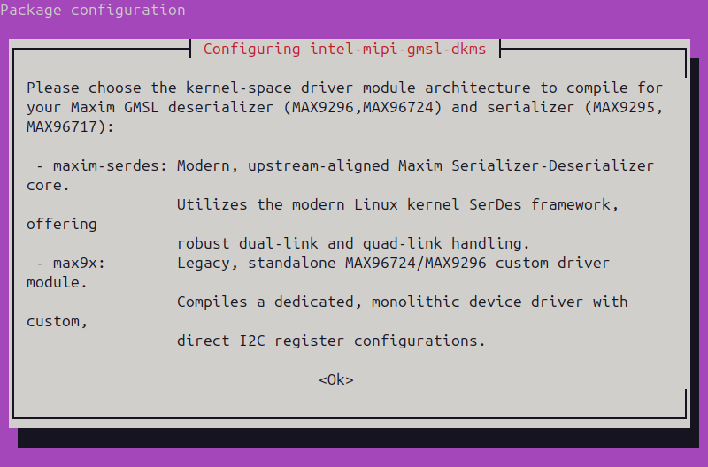
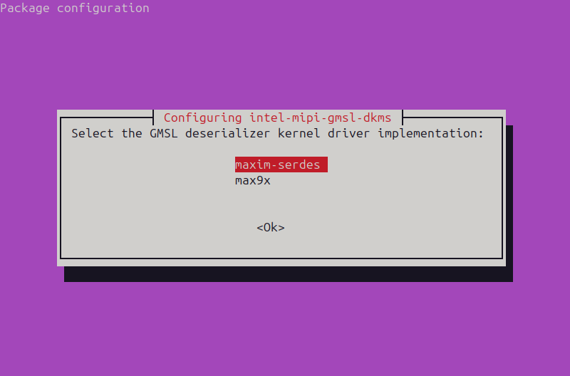
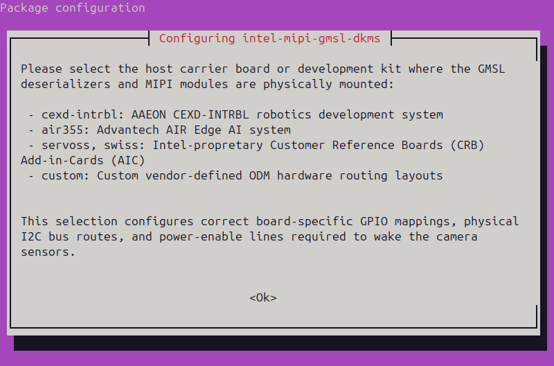
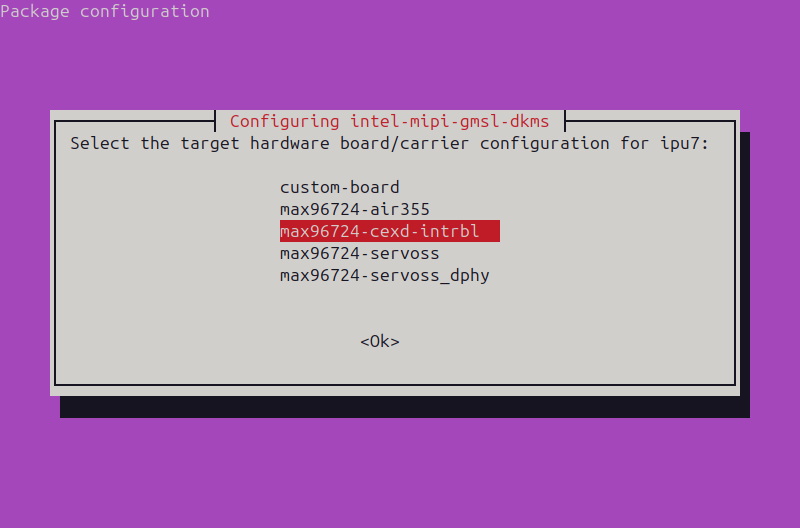
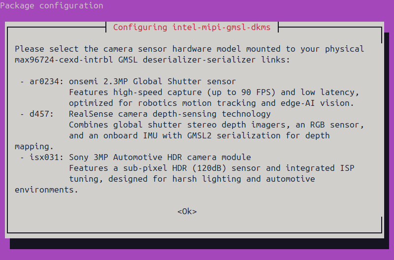
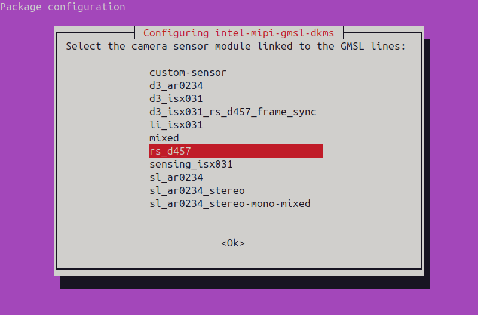
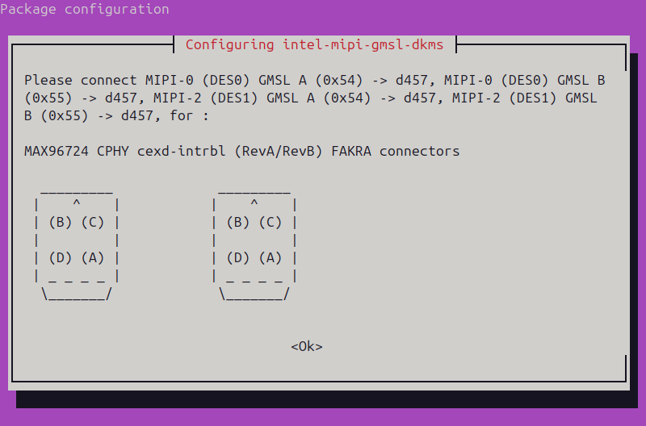

<!--
SPDX-FileCopyrightText: (C) 2026 Intel Corporation
SPDX-License-Identifier: Apache-2.0
-->

# GMSL Camera Setup with ACPI SSDT Overlay

This guide describes how to enable GMSL cameras using an ACPI SSDT
(Secondary System Description Table) overlay, and how to configure the camera
media pipeline in user space.
It covers the following cameras on the AAEON CEXD-INTRBL development kit:

- **D3 Embedded ISX031** (2D, single YUV stream)
- **RealSense D457** (3D, Depth, RGB, IR and IMU streams)

With the SSDT overlay method, the deserializer, serializers and sensors are
described in an ACPI table that is loaded by GRUB as an early `initrd` at boot.
The kernel enumerates the cameras from this table and the `maxim-serdes`
drivers register them with the V4L2 framework. The overlay does not depend on
BIOS fields and supports mixing different sensor models on the same
deserializer.

```{note}
The I2C bus numbers assigned to the GMSL devices are dynamic with the SSDT
overlay method and can change on every boot. The media pipeline is therefore
built at runtime by the `mc-setup.sh` script from the ACPI paths of each
device, rather than from a static configuration.
```

## Validated Cameras

```{include} fragment_camera_table_gmsl.md
```

## Prerequisites

- Complete the [Getting Started](../../../../platform_foundation/getting_started.md)
  guide, including the Intel APT repository setup.
- Use the IPU7 platform kernel. The kernel must provide the `i2c_atr`
  module (`CONFIG_I2C_ATR`), which is required by the `maxim-serdes` drivers.
- `media-ctl` version 1.30 or newer. The `v4l-utils` package from the Intel
  APT repository meets this requirement:

  ```bash
  sudo apt-get install v4l-utils ffmpeg
  media-ctl --version
  ```

## Step 1: Disable BIOS Camera Configuration

BIOS camera settings create ACPI camera devices that conflict with the SSDT
overlay. Disable all camera settings in the BIOS before loading the overlay.

On the AAEON CEXD-INTRBL, open the `System IO` menu in the BIOS and set
`Camera1`, `Camera2` and `Camera3` to `Disabled`. See the
[CEXD-INTRBL GMSL guide](../../../../platform_foundation/development_kits/robinson-bay/interfaces/gmsl.md)
for screenshots of this menu.

## Step 2: Connect the Cameras

The AAEON CEXD-INTRBL has two 4-in-1 mini-FAKRA connectors, each connected
to one MAX96724 deserializer over C-PHY:

| Connector | Deserializer (`mc-setup.sh`) | MIPI Port | I2C Bus |
| --- | --- | --- | --- |
| Left  | `DES0` | 0 | I2C0 |
| Right | `DES1` | 2 | I2C1 |

Each connector has four GMSL links, labeled **A** to **D**, which map to
`CH0` to `CH3` in `mc-setup.sh`. The position of each link, viewed with
the connector key (`^`) at the top, depends on the board revision:

::::{tab-set}
:::{tab-item} **Rev A / Rev B**

```text
  Left (DES0)        Right (DES1)
   _________          _________
  |    ^    |        |    ^    |
  | (B) (C) |        | (B) (C) |
  |         |        |         |
  | (D) (A) |        | (D) (A) |
  | _ _ _ _ |        | _ _ _ _ |
   \_______/          \_______/
```

| Link | `mc-setup.sh` | Left connector | Right connector |
| --- | --- | --- | --- |
| A | `CH0` | Lower-right | Lower-right |
| B | `CH1` | Upper-left  | Upper-left  |
| C | `CH2` | Upper-right | Upper-right |
| D | `CH3` | Lower-left  | Lower-left  |

:::
:::{tab-item} **Rev C**

```text
  Left (DES0)        Right (DES1)
   _________          _________
  |    ^    |        |    ^    |
  | (C) (B) |        | (D) (B) |
  |         |        |         |
  | (D) (A) |        | (C) (A) |
  | _ _ _ _ |        | _ _ _ _ |
   \_______/          \_______/
```

| Link | `mc-setup.sh` | Left connector | Right connector |
| --- | --- | --- | --- |
| A | `CH0` | Lower-right | Lower-right |
| B | `CH1` | Upper-right | Upper-right |
| C | `CH2` | Upper-left  | Lower-left  |
| D | `CH3` | Lower-left  | Upper-left  |

:::
::::

Connect the cameras to the links described by the overlay you select in
[Step 3](#step-3-install-the-driver-and-select-the-ssdt-overlay):

::::{tab-set}
:::{tab-item} **RealSense**
:sync: realsense

Overlay `rs_d457` describes four RealSense D457 cameras:

| Deserializer | Links |
| --- | --- |
| `DES0` (left)  | A (`CH0`), B (`CH1`) |
| `DES1` (right) | A (`CH0`), B (`CH1`) |

Each D457 uses up to four streams. Connect at most two D457 cameras per
deserializer.

:::
:::{tab-item} **D3 Embedded**
:sync: d3embedded

Overlay `d3_isx031` describes eight D3 Embedded ISX031 cameras:

| Deserializer | Links |
| --- | --- |
| `DES0` (left)  | A (`CH0`), B (`CH1`), C (`CH2`), D (`CH3`) |
| `DES1` (right) | A (`CH0`), B (`CH1`), C (`CH2`), D (`CH3`) |

:::
::::

```{warning}
The overlay must match, or be a subset of, the cameras that are physically
connected. If the overlay describes a camera that is not connected, or any
link fails to probe, V4L2 sub-device registration fails and none of the
cameras can stream.
```

## Step 3: Install the Driver and Select the SSDT Overlay

Install the GMSL driver package:

```bash
sudo apt-get update
sudo apt-get install intel-mipi-gmsl-dkms
```

If the package is already installed, run the configuration dialog again with:

```bash
sudo dpkg-reconfigure intel-mipi-gmsl-dkms
```

Answer the configuration dialog as follows:

| Prompt | Selection |
| --- | --- |
| GMSL deserializer kernel driver | `maxim-serdes` |
| IPU generation | `ipu7` (detected automatically on supported platforms) |
| Target hardware board | `max96724-cexd-intrbl` |
| Camera sensor module | `rs_d457` for RealSense D457, or `d3_isx031` for D3 Embedded ISX031 |

The dialog screens appear in the following order. The screenshots show the
selections for RealSense D457. Press `Enter` on `<Ok>` to continue to the next
screen.

1. Read the description of the deserializer kernel drivers.

   

2. Select `maxim-serdes`.

   

3. Read the description of the supported carrier boards.

   

4. Select `max96724-cexd-intrbl`.

   

5. Read the description of the supported camera sensors.

   

6. Select `rs_d457` or `d3_isx031`.

   

7. Confirm that the cameras are connected to the FAKRA links shown for the
   selected overlay.

   

Selecting `maxim-serdes` enables the SSDT overlay method. After the sensor
selection, the dialog shows the FAKRA links that must be connected for the
chosen overlay. The package then:

1. Packs the prebuilt overlay from `/usr/share/camera/acpi/ipu7/` into
   `/boot/ipu7_max96724-cexd-intrbl_<sensor>_ssdt.img`.
2. Writes `GRUB_EARLY_INITRD_LINUX_CUSTOM` to `/etc/default/grub.d/ssdt.cfg`.
3. Runs `update-grub`.

**A reboot is required to load the overlay.**

```bash
sudo reboot
```

## Step 4: Verify the SSDT Overlay and Drivers

Confirm that the kernel loaded the overlay from the `initrd`:

```bash
sudo dmesg | grep SSDT
```

You should see output similar to:

```console
ACPI: SSDT ACPI table found in initrd [kernel/firmware/acpi/max96724-cexd-intrbl_d3_isx031.aml][0x143d]
ACPI: Table Upgrade: install [SSDT-      - IMG_IPU]
ACPI: SSDT 0x00000000678E6000 00143D (v02        IMG_IPU  20260513 INTL 20250404)
```

Confirm that the `i2c_atr` module is used by `max_serdes`:

```bash
lsmod | grep i2c_atr
```

```console
i2c_atr                24576  1 max_serdes
```

Confirm that the deserializer, serializer and sensor entities are registered
in the media graph:

::::{tab-set}
:::{tab-item} **RealSense**
:sync: realsense

```bash
media-ctl -p | grep -E "entity .*(max96724|max96717|DS5 mux|D4XX)"
```

Each D457 registers a `max96717` serializer, a `DS5 mux` entity, and one
`D4XX depth`, `D4XX rgb`, `D4XX ir` and `D4XX imu` entity.

:::
:::{tab-item} **D3 Embedded**
:sync: d3embedded

```bash
media-ctl -p | grep -E "entity .*(max96724|max96717|isx031)"
```

Each ISX031 registers a `max96717` serializer and an `isx031` entity.

:::
::::

If no camera entities are listed, check that all BIOS camera settings are
disabled and that the connected cameras match the overlay.

## Step 5: Configure the Media Pipeline

The `mc-setup.sh` script discovers the cameras from ACPI and sysfs, then uses
`media-ctl` to program the routes and formats from each sensor through the
serializer, deserializer and IPU CSI-2 receiver to the capture video nodes.

A udev rule runs the script automatically when the cameras are enumerated at
boot, which configures the default streams on every link:

| Camera | Default streams |
| --- | --- |
| RealSense D457 | Depth and RGB |
| D3 Embedded ISX031 | Single YUV stream |

Run the script again to print the current configuration, or to change the
links, streams, resolution, format or frame rate:

```bash
sudo /usr/share/camera/acpi/mc-setup.sh
```

### Command Syntax

Each argument configures one link. Without arguments, the script configures
all links with their default streams. Combine the following comma-separated
tokens in each argument:

| Token | Description | Example |
| --- | --- | --- |
| `des=<N>` | Deserializer index | `des=0` |
| `link=<N>` | GMSL link on the deserializer, `0` to `3` | `link=1` |
| `stream=<list>` | RealSense D457 only. Any of `depth`, `rgb`, `ir`, `imu` | `stream=depth,rgb` |
| `res=<W>x<H>` | Resolution | `res=1280x720` |
| `format=<code>` | Media bus format | `format=UYVY8_1X16` |
| `fps=<N>` | Frame rate | `fps=60` |

To configure each D457 stream individually, wrap the stream settings in
brackets, for example `stream=[depth,res=848x480,fps=60],[rgb]`. A stream
listed without settings keeps its current configuration. Quote arguments that
contain brackets to prevent shell globbing.

```{note}
Each MAX96724 deserializer supports a maximum of four streams in total across
all of its links. For example, two D457 cameras with Depth and RGB use all
four streams on one deserializer.
```

The script prints a configuration summary that maps each stream to a capture
video node. Use these video nodes in the following steps. The numbers depend
on the system and the selected streams.

::::{tab-set}
:::{tab-item} **RealSense**
:sync: realsense

**Default streams on all links**

```bash
sudo /usr/share/camera/acpi/mc-setup.sh
```

```console
Configuration summary:
DES0 CH0        Sensor model    d4xx
                Stream          [depth]  1280x720   UYVY8_1X16    30.000 FPS -->  /dev/video0
                Stream          [rgb]    1280x800   YUYV8_1X16    30.000 FPS -->  /dev/video4
DES0 CH1        Sensor model    d4xx
                Stream          [depth]  1280x720   UYVY8_1X16    30.000 FPS -->  /dev/video1
                Stream          [rgb]    1280x800   YUYV8_1X16    30.000 FPS -->  /dev/video5
DES1 CH0        Sensor model    d4xx
                Stream          [depth]  1280x720   UYVY8_1X16    30.000 FPS -->  /dev/video16
                Stream          [rgb]    1280x800   YUYV8_1X16    30.000 FPS -->  /dev/video20
DES1 CH1        Sensor model    d4xx
                Stream          [depth]  1280x720   UYVY8_1X16    30.000 FPS -->  /dev/video17
                Stream          [rgb]    1280x800   YUYV8_1X16    30.000 FPS -->  /dev/video21
```

**All four streams from one D457 for the RealSense SDK**

The RealSense SDK expects the following formats:

| Stream | Format |
| --- | --- |
| Depth | `FIXED` (exposed as `Z16` on the video node) |
| RGB | `YUYV8_1X16` |
| IR | `VYUY8_1X16` |
| IMU | `Y8_1X8` |

```bash
sudo /usr/share/camera/acpi/mc-setup.sh \
  'des=0,link=0,stream=[depth,format=FIXED,res=1280x720,fps=30],[rgb,format=YUYV8_1X16,res=1280x800,fps=30],[ir,format=VYUY8_1X16,res=1280x720,fps=30],[imu,format=Y8_1X8,res=38x1,fps=400]'
```

```console
Configuration summary:
DES0 CH0        Sensor model    d4xx
                Stream          [depth]  1280x720   UYVY8_1X16    30.000 FPS -->  /dev/video0
                Stream          [rgb]    1280x800   YUYV8_1X16    30.000 FPS -->  /dev/video4
                Stream          [ir]     1280x720   VYUY8_1X16    30.000 FPS -->  /dev/video6
                Stream          [imu]    38x1       Y8_1X8       400.000 FPS -->  /dev/video2
```

`FIXED` is routed as `UYVY8_1X16` through the pipeline, while the video node
is configured as `Z16` so that the RealSense SDK recognizes the Depth stream.

**Different settings for two D457 cameras**

```bash
sudo /usr/share/camera/acpi/mc-setup.sh \
  'des=0,link=0,stream=[depth,format=UYVY8_1X16,res=1280x720,fps=30],[rgb,format=YUYV8_1X16,res=1280x800,fps=30]' \
  'des=0,link=1,stream=[depth,format=UYVY8_1X16,res=640x480,fps=90],[rgb,format=YUYV8_1X16,res=424x240,fps=5]'
```

```console
Configuration summary:
DES0 CH0        Sensor model    d4xx
                Stream          [depth]  1280x720   UYVY8_1X16    30.000 FPS -->  /dev/video0
                Stream          [rgb]    1280x800   YUYV8_1X16    30.000 FPS -->  /dev/video4
DES0 CH1        Sensor model    d4xx
                Stream          [depth]  640x480    UYVY8_1X16    90.000 FPS -->  /dev/video1
                Stream          [rgb]    424x240    YUYV8_1X16     5.000 FPS -->  /dev/video5
```

**Supported configurations**

| Stream | Format | Resolution | FPS |
| --- | --- | --- | --- |
| Depth | `FIXED`, `UYVY8_1X16` | 1280x720 | 30, 15, 5 |
| | | 848x480 | 90, 60, 30, 15, 5 |
| | | 848x100 | 100 |
| | | 640x480 | 90, 60, 30, 15, 5 |
| | | 848x360 | 90, 60, 30, 15, 5 |
| | | 480x270 | 90, 60, 30, 15, 5 |
| | | 424x240 | 90, 60, 30, 15, 5 |
| | | 256x144 | 90 |
| RGB | `YUYV8_1X16` | 1280x800 | 30, 15, 10, 5 |
| | | 1280x720 | 30, 15, 10, 5 |
| | | 848x480 | 60, 30, 15, 5 |
| | | 640x480 | 60, 30, 15, 5 |
| | | 640x360 | 90, 60, 30, 15, 5 |
| | | 480x270 | 90, 60, 30, 15, 5 |
| | | 424x240 | 90, 60, 30, 15, 5 |
| IR | `Y8_1X8`, `VYUY8_1X16` | 1280x720 | 30, 15, 5 |
| | | 848x480 | 90, 60, 30, 15, 5 |
| | | 640x480 | 90, 60, 30, 15, 5 |
| | | 640x360 | 90, 60, 30, 15, 5 |
| | | 480x270 | 90, 60, 30, 15, 5 |
| | | 424x240 | 90, 60, 30, 15, 5 |
| | `RGB888_1X24` | 1280x800 | 30, 15 |
| IMU | `Y8_1X8` | 38x1 | 400, 200, 100, 50 |

When streaming Depth and IR from the same camera at the same time, configure
both with the same resolution.

:::
:::{tab-item} **D3 Embedded**
:sync: d3embedded

**Default stream on all links**

```bash
sudo /usr/share/camera/acpi/mc-setup.sh
```

```console
Configuration summary:
DES0 CH0        Sensor model    isx031
                Stream          [single] 1920x1536  UYVY8_1X16    30.000 FPS -->  /dev/video0
DES0 CH1        Sensor model    isx031
                Stream          [single] 1920x1536  UYVY8_1X16    30.000 FPS -->  /dev/video1
DES0 CH2        Sensor model    isx031
                Stream          [single] 1920x1536  UYVY8_1X16    30.000 FPS -->  /dev/video2
DES0 CH3        Sensor model    isx031
                Stream          [single] 1920x1536  UYVY8_1X16    30.000 FPS -->  /dev/video3
DES1 CH0        Sensor model    isx031
                Stream          [single] 1920x1536  UYVY8_1X16    30.000 FPS -->  /dev/video16
...
```

**Selected links on one deserializer**

```bash
sudo /usr/share/camera/acpi/mc-setup.sh des=0,link=1 des=0,link=2
```

```console
Configuration summary:
DES0 CH1        Sensor model    isx031
                Stream          [single] 1920x1536  UYVY8_1X16    30.000 FPS -->  /dev/video1
DES0 CH2        Sensor model    isx031
                Stream          [single] 1920x1536  UYVY8_1X16    30.000 FPS -->  /dev/video2
```

**Change resolution and frame rate**

```bash
sudo /usr/share/camera/acpi/mc-setup.sh des=0,link=0,res=1920x1080,fps=60
```

```console
Configuration summary:
DES0 CH0        Sensor model    isx031
                Stream          [single] 1920x1080  UYVY8_1X16    60.000 FPS -->  /dev/video0
```

**Supported configurations**

| Format | Resolution | FPS |
| --- | --- | --- |
| `UYVY8_1X16` | 1920x1536 | 60, 30 |
| | 1920x1080 | 60, 30 |
| | 1280x720 | 30 |

:::
::::

## Step 6: Create RealSense Symlinks

::::{tab-set}
:::{tab-item} **RealSense**
:sync: realsense

The RealSense SDK locates D457 cameras through `/dev/video-rs-*` symlinks.
A udev rule creates them at boot. After you change the pipeline with
`mc-setup.sh`, recreate the symlinks:

```bash
sudo /usr/share/camera/acpi/upstream-rs-enum.sh
ls -l /dev/video-rs-*
```

Two types of symlinks are created for each enabled stream, where `<type>`
is `depth`, `color`, `ir` or `imu`, and `<index>` identifies the camera:

| Symlink | Target | Example |
| --- | --- | --- |
| `/dev/video-rs-<type>-<index>` | Capture video node | `/dev/video-rs-depth-0 -> /dev/video0` |
| `/dev/video-rs-<type>-sd-<index>` | Sensor sub-device used for camera controls | `/dev/video-rs-depth-sd-0 -> /dev/v4l-subdev10` |

The capture video node targets match the `mc-setup.sh` configuration
summary.

:::
:::{tab-item} **D3 Embedded**
:sync: d3embedded

This step is not required for D3 Embedded ISX031 cameras. Use the video
nodes from the `mc-setup.sh` configuration summary directly.

:::
::::

## Step 7: Verify Streaming

Replace `/dev/videoN` with a video node from the `mc-setup.sh` configuration
summary. The resolution, format and frame rate must match the configured
pipeline, otherwise streaming fails to start.

### Stream with `v4l2-ctl`

Stream 150 frames and report the frame rate:

```bash
v4l2-ctl -d /dev/videoN --stream-mmap --stream-count=150
```

You should see output similar to:

```console
<<<<<<<<<<<<<<<<<<<<<<<<<<<<<<< 29.99 fps
<<<<<<<<<<<<<<<<<<<<<<<<<<<< 29.99 fps
<<<<<<<<<<<<<<<<<<<<<<<<<<<< 29.99 fps
<<<<<<<<<<<<<<<<<<<<<<<<<<<< 29.99 fps
<<<<<<<<<<<<<<<<<<<<<<<<<<<< 29.99 fps
```

### Capture a Live Image

::::{tab-set}
:::{tab-item} **RealSense**
:sync: realsense

Capture a single frame from the RGB stream with `ffmpeg` and view it:

```bash
ffmpeg -f v4l2 -i /dev/video-rs-color-0 -frames:v 1 frame.jpg
xdg-open frame.jpg
```

Or view the live RGB stream with `ffplay`:

```bash
ffplay -f v4l2 -i /dev/video-rs-color-0
```

:::
:::{tab-item} **D3 Embedded**
:sync: d3embedded

Capture a single frame with `ffmpeg` and view it:

```bash
ffmpeg -f v4l2 -i /dev/videoN -frames:v 1 frame.jpg
xdg-open frame.jpg
```

Or view the live video stream with `ffplay`:

```bash
ffplay -f v4l2 -i /dev/videoN
```

:::
::::

### Stream with GStreamer

Install the GStreamer tools and plugins:

```bash
sudo apt-get install gstreamer1.0-tools gstreamer1.0-plugins-good gstreamer1.0-gl
```

::::{tab-set}
:::{tab-item} **RealSense**
:sync: realsense

```bash
# Depth (UYVY8_1X16)
gst-launch-1.0 v4l2src device=/dev/videoN ! 'video/x-raw,format=UYVY,width=1280,height=720,framerate=30/1' ! glimagesink

# RGB (YUYV8_1X16)
gst-launch-1.0 v4l2src device=/dev/videoN ! 'video/x-raw,format=YUY2,width=1280,height=800,framerate=30/1' ! glimagesink

# IR (Y8_1X8)
gst-launch-1.0 v4l2src device=/dev/videoN ! 'video/x-raw,format=GRAY8,width=1280,height=720,framerate=30/1' ! glimagesink
```

The IMU stream is not supported by `v4l2src`. The Depth stream contains raw
16-bit depth data and is displayed as an unconverted image.

:::
:::{tab-item} **D3 Embedded**
:sync: d3embedded

```bash
gst-launch-1.0 v4l2src device=/dev/videoN ! 'video/x-raw,format=UYVY,width=1920,height=1536,framerate=30/1' ! glimagesink
```

:::
::::

## Known Limitations

- **RealSense D457:** The RGB stream can only be started once if no Depth
  stream is configured and running. To restart the RGB stream repeatedly,
  configure the Depth stream with `mc-setup.sh`, then start and stop the
  Depth stream before starting any other stream.
- **RealSense D457:** Some video nodes are shared between links. The IR stream
  of one link can use the same video node as the RGB stream of another link,
  and the IMU stream can use the same video node as a Depth stream. Do not
  enable streams that share a video node at the same time. Check the
  `mc-setup.sh` configuration summary for conflicts.
- **RealSense D457:** If the camera reports an unrecoverable I2C error
  (`-121`), rebooting does not recover it. Power cycle the camera.

## Next Steps

- Use OpenVINO™ to stream GMSL video data into a YOLO-based computer vision
  sample: [OpenVINO™ RealSense AI Demo](../../../../ai_resources/openvino/reference_applications/openvino_multicam_demo.md)
- Use ROS 2 to ingest camera frames for use in a ROS-powered application:
  [RealSense ROS2 Node](../../reference_applications/realsense-ros2.md)
