# KVM Robotics Configurator Guide

This guide explains how to use KVM Robotics Configurator to configure host CPU topology, task groups, and virtual machines. The interface uses the current host's hardware information to generate preflight results, boot parameters, and VM files. Example CPU IDs and resource values are illustrative; adjust them to suit your target host.

## Feature Overview

KVM Robotics Configurator provides three main modules:

| Module           | Purpose                                                                                                                                                         |
| ---------------- | --------------------------------------------------------------------------------------------------------------------------------------------------------------- |
| **CPU Topology** | Assign logical CPUs to Guest, Robotics, and Realtime groups, preview real-time configuration, and apply CPU isolation settings.                                 |
| **Task group**   | Configure task admission rules for Guest, Robotics, and Realtime groups. Guest and Robotics also provide an editor for tasks launched through executable paths. |
| **VM setting**   | Configure VM resources, PCI passthrough, and virtual devices, and generate QEMU launch scripts and libvirt XML.                                                 |

CPU Topology is the foundation for the other two modules: VM setting uses the Guest CPU set for the VM, while Task group displays and uses the corresponding CPU sets from CPU Topology.

## Before You Begin

### System and Software Requirements

- Ubuntu 22.04 or 24.04.
- The embedded application window requires Python GObject, GTK 3, and WebKit2GTK runtime packages appropriate for your Ubuntu version. See the project [README](../README.md) for package names and installation instructions.

### Launching the Tool

**Desktop Access**

Open a terminal on the Linux host where the tool is installed and run:

```bash
sudo kvm-config-tool
```

The launcher automatically starts the backend service. On a system with a graphical desktop and the required runtime dependencies, it also opens a standalone **KVM Robotics Configurator** application window; you do not need to open a browser separately. 

**Browser Access**

Once the tool is running, you can also access the same configuration interface in a browser:

- On the Linux host running the tool, open `http://localhost:4173`.
- From another computer, open `http://<Linux-host-IP>:4173`. Replace `<Linux-host-IP>` with the actual address, and ensure that the network and firewall allow access.
- Without a graphical desktop, no application window will open, but browser access is still available. If you launch the tool from a terminal, keep that terminal running.

## Recommended Workflow

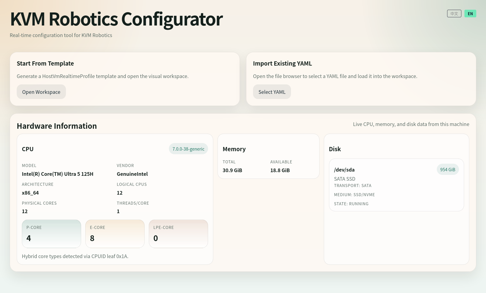

1. Review the target host's hardware information on the welcome page, then open the workspace.
2. Configure **CPU Topology** first, and review CPU assignments and the dry-run report.
3. Configure **Task group**, ensuring that task rules match the intended CPU groups.
4. Configure **VM setting**, then review the generated QEMU script and libvirt XML.
5. After completing configuration, save your work and restart the Linux host for the settings to take effect.

CPU IDs, core types, memory, PCI addresses, disk paths, and bootloader configurations vary between hosts. Do not copy the example values below without checking the target machine.

## CPU Topology

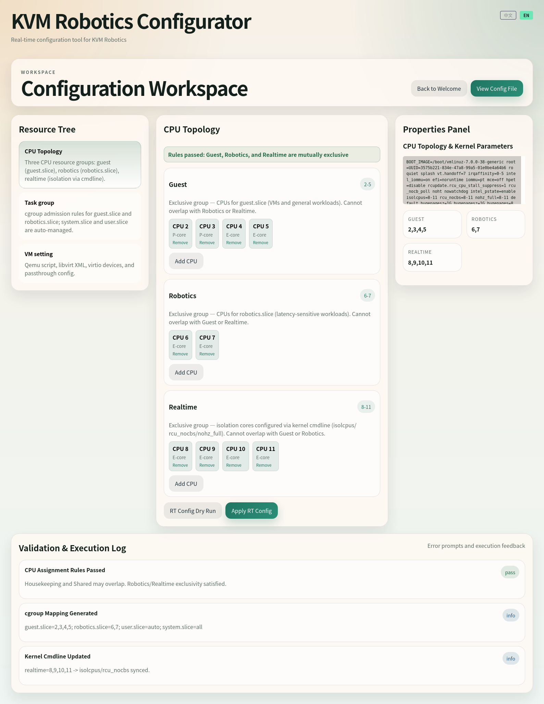

### Understanding CPU Groups

The CPU list comes from the target host's hardware information. CPUs may be identified as P-cores, E-cores, LPE-cores, or Unknown. The interface assigns logical CPUs to three mutually exclusive groups:

| Group        | Purpose                                        | Related Configuration                                                                               |
| ------------ | ---------------------------------------------- | --------------------------------------------------------------------------------------------------- |
| **Guest**    | CPUs for Guest virtual machine workloads.      | Maps to `guest.slice`; the generated `irqaffinity` uses the Guest CPU set.                          |
| **Robotics** | CPUs for latency-sensitive robotics workloads. | Maps to `robotics.slice`.                                                                           |
| **Realtime** | CPUs for kernel-level real-time isolation.     | Used for `isolcpus`, `rcu_nocbs`, and `nohz_full`; Realtime tasks are not migrated through cgroups. |

Robotics and Realtime are exclusive groups and cannot overlap with other groups.

### Configuration Steps

1. Select **CPU Topology** in the left-hand navigation.
2. Click **Add CPU** for the relevant group. In the picker that opens, review CPU IDs and core types, then select the CPUs to add. Click an assigned CPU in the group to remove it.
3. Adjust the Guest, Robotics, and Realtime groups according to workload requirements and hardware topology.
4. Click **RT Config Dry Run** and wait for it to finish. A dry run only generates a configuration plan; it does not perform system tuning or write boot configuration.
5. Check that the CPU groups and target parameters in the plan match your selected assignments:
   - Guest CPU set -> `irqaffinity`
   - Realtime CPU set -> `isolcpus`, `rcu_nocbs`, and `nohz_full`
   - Robotics CPU set -> the CPU set for `robotics.slice`
   - In the right-hand properties panel, review **HWP Configuration**, **CAT Configuration Summary**, and **CAT Configuration**.
6. After confirming that the plan meets the target machine's requirements, click **Apply RT Config**. This runs the real-time configuration workflow and attempts to write the kernel boot configuration.
7. After confirming that the boot configuration was written successfully, restart the Linux host for the boot parameters to take effect.

## Task group

Task group associates task rules with CPU groups and cgroup slices. The interface provides **Guest**, **Robotics**, and **Realtime** tabs and displays the corresponding CPU sets from CPU Topology.

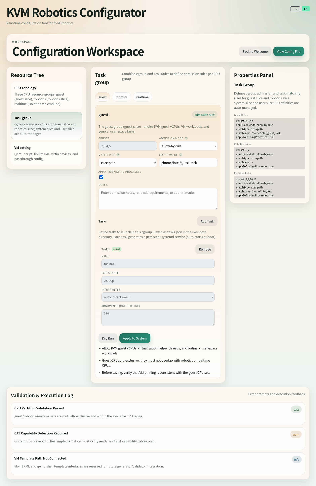

### Rule Fields

| Field                           | Description                                                                                        |
| ------------------------------- | -------------------------------------------------------------------------------------------------- |
| **cpuset**                      | Read-only CPU IDs synchronized from CPU Topology for the current group.                            |
| **admission mode**              | The current interface provides `allow-by-rule`, which admits tasks according to configured rules.  |
| **match type**                  | The current interface provides `exec-path`, using an executable path as the task entry point.      |
| **match value**                 | The value for the selected match type, such as an executable file path or its directory.           |
| **apply to existing processes** | Whether to apply the rule to processes that are already running. Disabled by default for Realtime. |
| **notes**                       | Operational notes, rollback requirements, or audit remarks for the group.                          |

### Guest and Robotics Task Lists

Guest and Robotics provide an editable task list in `exec-path` mode:

- **name**: The task name or the name used for its generated service.
- **exec**: The executable file path. If the executable is in the **match value** directory, you can use a relative path beginning with `./`.
- **interpreter**: Select automatic execution, `bash`, or `python3`.
- **args**: Launch arguments, one per line.

The following screenshot shows the editor after clicking **Add Task**. Placeholder examples in the input fields do not mean that a task has been configured or deployed.

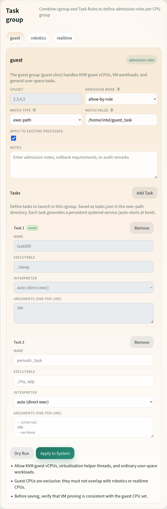

The task list is associated with the executable path and saved as `tasks.json` in that directory. The interface indicates that these tasks generate corresponding systemd services. Before saving or applying, verify the paths, executable permissions, interpreter, and arguments.

The Robotics tab uses the same task configuration workflow, but targets `robotics.slice` and the Robotics CPU set.

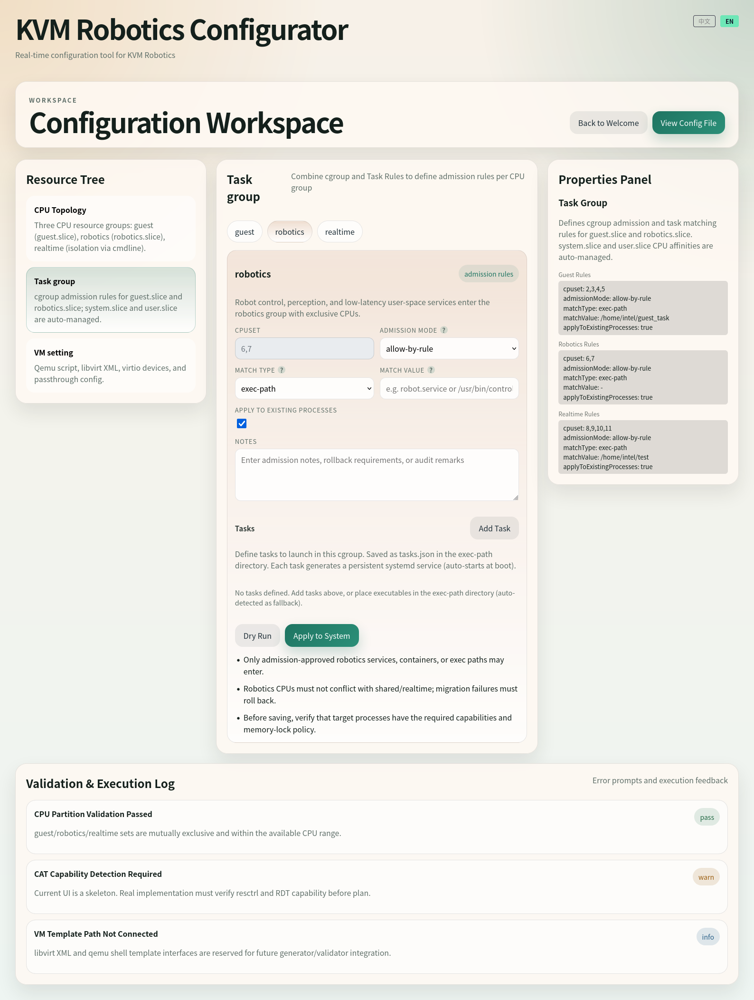

Realtime does not perform cgroup process migration. Its rule information records admission rules and scheduling policy; tasks run on the isolated CPUs configured in CPU Topology. The Realtime tab does not display the Guest/Robotics task editor.

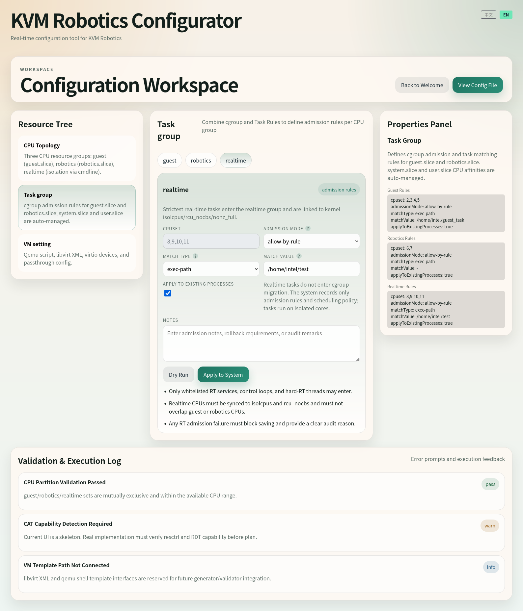

### Configuration Steps

1. Open **Task group** and select the Guest, Robotics, or Realtime tab.
2. Confirm that the read-only `cpuset` matches the corresponding group in CPU Topology.
3. Configure **admission mode**, **match type**, **match value**, whether to apply to existing processes, and any notes.
4. To manage launch tasks for Guest or Robotics, **`match value` must not be empty**. Enter the absolute path of an existing, writable task directory on the target host, such as `/home/intel/robot_tasks`. Then add tasks and enter their executable paths and arguments. Executables may be in other directories if you enter their absolute paths.
5. Click **Rules Dry Run** to review the report, including matching and migration results.
6. Once the results are correct, click **Apply To System**. The tool first saves the rules, then applies them. It generates `tasks.json` and `run_in_cgroups.sh` in the task directory specified by `match value`, and creates and starts systemd services for the tasks. Clicking **Add Task** alone does not generate these files. If `match value` is a file path, its parent directory is used.
7. To delete a task, click **Remove** for that task in the corresponding group's task list, then click **Apply To System**. Clicking **Remove** alone only changes the list on the page; it does not immediately delete the backend service. The current version handles deletion as follows:
   - **When other tasks remain in the group**: Updates `tasks.json` and `run_in_cgroups.sh`, disables automatic startup of the deleted task's service, and deletes its `.service` file. Services for the remaining tasks are retained.
   - **Items that are not deleted**: The task directory, executable files, and other user files. The `tasks.json` and `run_in_cgroups.sh` files themselves are also retained.

### Simple Example: Start a Task and Check Its cgroup

This example uses the **Guest** group. Copy the Linux `sleep` program to `/home/intel/guest_task`, use the tool to start a task that waits for 300 seconds, then check the service and the process's cgroup. Perform these steps on a test host. **Apply To System** processes all groups, so review the other groups before applying.

#### 1. Prepare the Test Program

On the Linux host running the tool, open a terminal as the `intel` user and run:

```bash
mkdir -p /home/intel/guest_task
cp /usr/bin/sleep /home/intel/guest_task/sleep
```

Do not start `sleep` manually yet. The tool will start it using the task configuration below.

#### 2. Configure and Apply in the Interface

First assign CPUs to Guest in **CPU Topology**, then open **Task group > Guest** and enter:

| Setting                         | Example Value                                                                                |
| ------------------------------- | -------------------------------------------------------------------------------------------- |
| **cpuset**                      | Confirm that it matches the Guest group in CPU Topology.                                     |
| **admission mode**              | `allow-by-rule`                                                                              |
| **match type**                  | `exec-path`                                                                                  |
| **match value**                 | `/home/intel/guest_task`                                                                     |
| **apply to existing processes** | Not required for this example, because no process has been started in advance for migration. |

Click **Add Task** and enter:

| Task Field      | Example Value             |
| --------------- | ------------------------- |
| **name**        | `task0`                   |
| **exec**        | `./sleep`                 |
| **interpreter** | Automatic execution       |
| **args**        | `300`, on a separate line |

Click **Rules Dry Run** first and confirm that the report contains no errors. Then click **Apply To System** and confirm that the execution report contains no errors. The dry run does not start the task.

After applying, the tool generates `tasks.json` and `run_in_cgroups.sh` in `/home/intel/guest_task`, and creates and starts `kvm-tool-guest-task0.service` to run `/home/intel/guest_task/sleep 300`.

#### 3. Check the Backend Task Service

In the terminal, run:

```bash
sudo systemctl status kvm-tool-guest-task0.service --no-pager
```

The **`active (running)`** status and the command `/home/intel/guest_task/sleep 300` indicate that the task service has started.

If the service is not running, check its logs:

```bash
sudo journalctl -u kvm-tool-guest-task0.service -n 30 --no-pager
```

#### 4. Check the Process ID and cgroup

In the same terminal, run the following commands to obtain the task's process ID:

```bash
TASK_PID=$(systemctl show kvm-tool-guest-task0.service -p MainPID --value)
echo "Task process PID: $TASK_PID"
```

After confirming that the PID is a nonzero number, check the process's cgroup:

```bash
cat "/proc/$TASK_PID/cgroup"
```

On a host using cgroup v2, the expected output looks like:

```text
0::/guest.slice/kvm-tool-guest-task0.service
```

A path under `/guest.slice/` indicates that the task process belongs to the Guest group. This example verifies that **a task started by the tool enters the target cgroup**, not that a previously running process has been migrated.

To check the CPU range, also run:

```bash
grep '^Cpus_allowed_list:' "/proc/$TASK_PID/status"
```

The CPU IDs should match the Guest CPU set assigned in CPU Topology.

`sleep 300` exits after 300 seconds, so complete these checks before then. If the PID is `0` or the process no longer exists, check the service status first. If the waiting period has simply ended, run `sudo systemctl restart kvm-tool-guest-task0.service`, then obtain the PID again and repeat the checks.

## VM setting

VM setting uses CPU Topology and host resources to generate QEMU launch scripts and libvirt domain XML. VM vCPUs use the Guest CPU set.

### Host and VM Configuration

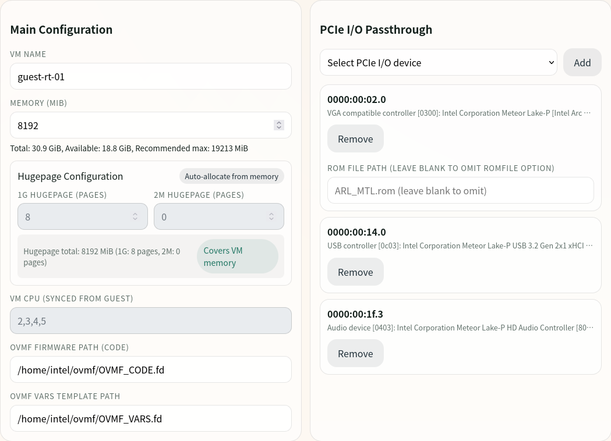

| Setting                   | Description                                                                                                                                                   |
| ------------------------- | ------------------------------------------------------------------------------------------------------------------------------------------------------------- |
| **VM name**               | Used for generated files and the VM definition. Only letters, digits, periods, underscores, and hyphens are allowed.                                          |
| **Memory**                | VM memory in MiB. The page checks this against the host's total and available memory.                                                                         |
| **Hugepage**              | Calculates the required number of 1 GiB or 2 MiB Hugepages from VM memory. Click **Auto-allocate from memory** to recalculate using the current memory value. |
| **VM CPU**                | Read-only CPUs synchronized from the Guest CPU set.                                                                                                           |
| **OVMF code / vars path** | Firmware file paths. If you use custom OVMF files, enter paths that exist on the target host.                                                                 |

Hugepage counts are recalculated automatically when memory changes. Memory values that are multiples of 1 GiB use 1 GiB pages; other values use 2 MiB pages, rounded up. Confirm that the host can provide the required Hugepages, reserve sufficient resources, and review the validation messages on the page.

### PCI Passthrough

1. Select and add the target devices from the PCI device list.
2. Carefully verify PCI addresses and device descriptions. Select only devices that may be transferred from the Host to the Guest.
3. If you select an Intel iGPU at `00:02.0`, enter the required ROM file path if needed.

### Virtual Devices

Click the corresponding button to add a device, then review the generated defaults for your target environment:

| Device         | Common Settings                                       | Description                                                                                                                                                                                                              |
| -------------- | ----------------------------------------------------- | ------------------------------------------------------------------------------------------------------------------------------------------------------------------------------------------------------------------------ |
| **virtio-net** | TAP name, Bridge name, MAC address                    | Must match the host network configuration. The default Bridge name is `kvm-br0`; each VM must have a unique MAC address. After completing configuration, restart the system for the bridge configuration to take effect. |
| **virtio-blk** | Image path, format, queue count                       | Confirm that the image exists, its format is correct, and the queue count suits the QEMU/Guest environment.                                                                                                              |
| **ivshmem**    | Shared memory size, socket path, vectors, server path | Configures an ivshmem device. You must compile `ivshmem-server` yourself and place it on the target host. Enter the actual path of the compiled program and ensure that all related paths are accessible.                |
| **monitor**    | Listen address, port                                  | The default listen address is `127.0.0.1`. Do not bind to an external network address without evaluating network access controls.                                                                                        |
| **console**    | No additional parameters                              | Generates serial console configuration.                                                                                                                                                                                  |

#### virtio-net Network Configuration

Enter the device name, TAP interface name, Bridge name, and MAC address. The screenshot uses network settings already saved on this host. The bridge configuration takes effect after a restart.

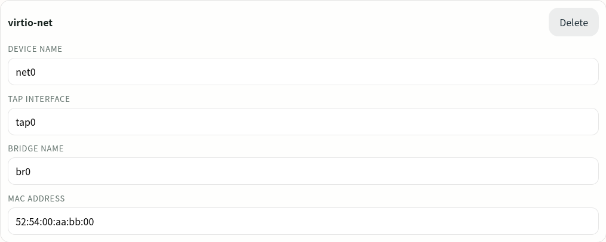

#### virtio-blk Disk Configuration

Enter the image path, select `qcow2` or `raw`, and set the queue count. First confirm that the image file exists and is accessible to the user running the VM.

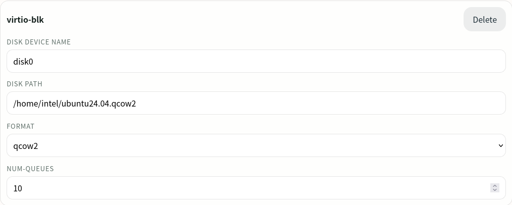

#### ivshmem Shared Memory Configuration

Configure the shared memory name, size, socket path, vectors, and ivshmem-server path. Replace the server path shown in the screenshot with its actual installation path on the target host.

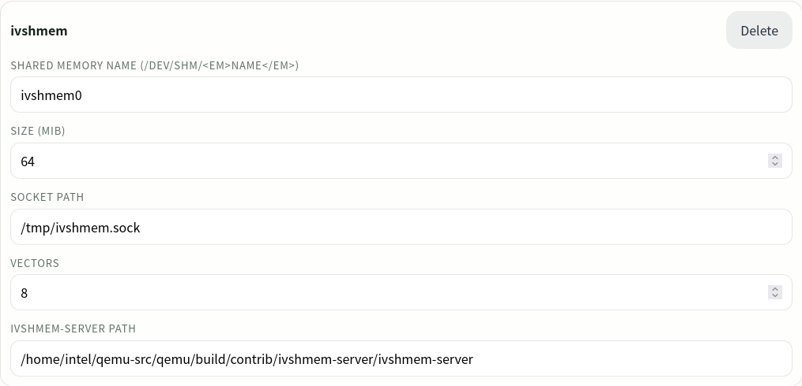

#### Monitor Configuration

Configure the listen address and port. Listening on a local address limits network access; do not expose an unprotected QEMU Monitor to external networks.

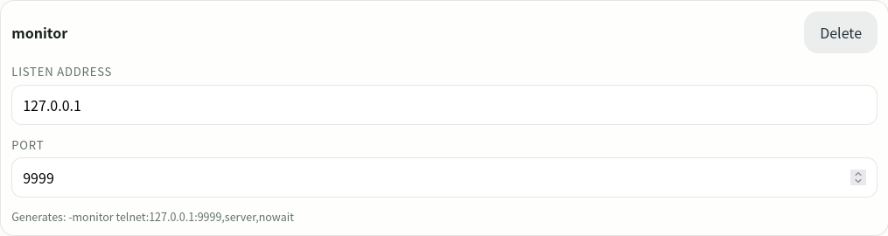

#### Console Configuration

Adding a Console generates serial console configuration. This device requires no additional parameters.


### Generating Configuration

1. Confirm that CPU Topology is configured and CPUs have been assigned to Guest.
2. Enter the VM name, memory, and firmware paths, select PCI passthrough devices, and add the required virtual devices.
3. Review Hugepage, memory, device, and CPU validation status. Investigate any warnings; an enabled generation button alone does not mean the configuration will run successfully.
4. Click **Generate** to generate and display the QEMU launch script and libvirt XML. After confirming that the files were saved and the boot configuration was written successfully, restart the Linux host for CPU isolation, Hugepage, and other boot parameters to take effect.

The following screenshot shows the QEMU and libvirt preview areas before generation. Once generation succeeds, these areas display the script and XML. Generation was not performed for this screenshot to avoid changing the host configuration.

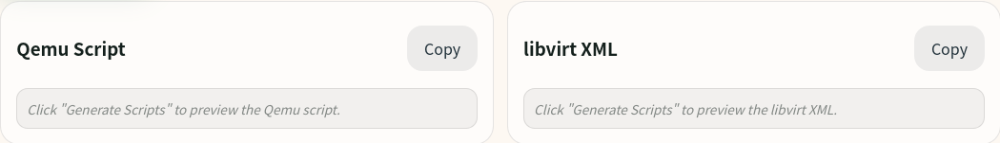

### Where Generated Files Are Saved

Files are saved on **the Linux host running KVM Config Tool**. By default, they are stored under the home directory of the login user who launched the tool:

```text
~/.kvm_robotics/vm_scripts/<VM-name>/
├── start_<VM-name>.sh    QEMU launch script
└── <VM-name>.xml         libvirt VM configuration
```

For example, with login user `intel` and VM name `vm1`:

- QEMU script: `/home/intel/.kvm_robotics/vm_scripts/vm1/start_vm1.sh`
- libvirt XML: `/home/intel/.kvm_robotics/vm_scripts/vm1/vm1.xml`

### Starting the VM: Choose One Method

Run the following commands in **a terminal on the target Linux host**. These examples use `vm1`; replace it with your VM name and actual file paths. Before starting, confirm that generation and saving succeeded, required restarts are complete, and disk images, firmware, networking, and passthrough devices are ready. If using ivshmem, also prepare your compiled `ivshmem-server`.

**QEMU and libvirt are two ways to start the same VM. Do not use both at the same time or allow two VMs to use the same writable disk image simultaneously.** To switch methods, shut down the Guest normally and confirm that the original VM has stopped.

#### Method 1: Start with the QEMU Script

```bash
sudo bash "$HOME/.kvm_robotics/vm_scripts/vm1/start_vm1.sh"
```

**Warning: Passing through a graphics device currently used by the host may close the host desktop.** Save your work and prepare another way to manage the host first. If startup fails, check the terminal output before trying again.

#### Method 2: Import and Start with libvirt

Confirm that libvirt is installed and its service is running on the target host, then run:

```bash
# Import for the first time; import again after changing and regenerating the XML.
sudo virsh define "$HOME/.kvm_robotics/vm_scripts/vm1/vm1.xml"

# Start the VM.
sudo virsh start vm1

# Check VM status.
sudo virsh list --all

# Shut down the VM.
sudo virsh shutdown vm1
```

## Viewing and Exporting Workspace Configuration

Click **View Config File** in the upper-right corner of the workspace to preview the current `HostVmRealtimeProfile` YAML, which includes CPU Topology and cgroup/Task group configuration. VM setting generates QEMU scripts and libvirt XML separately. You can:

- **Choose Config Folder** and save as `kvm-rt-profile.generated.yaml`.
- **Download File** locally.

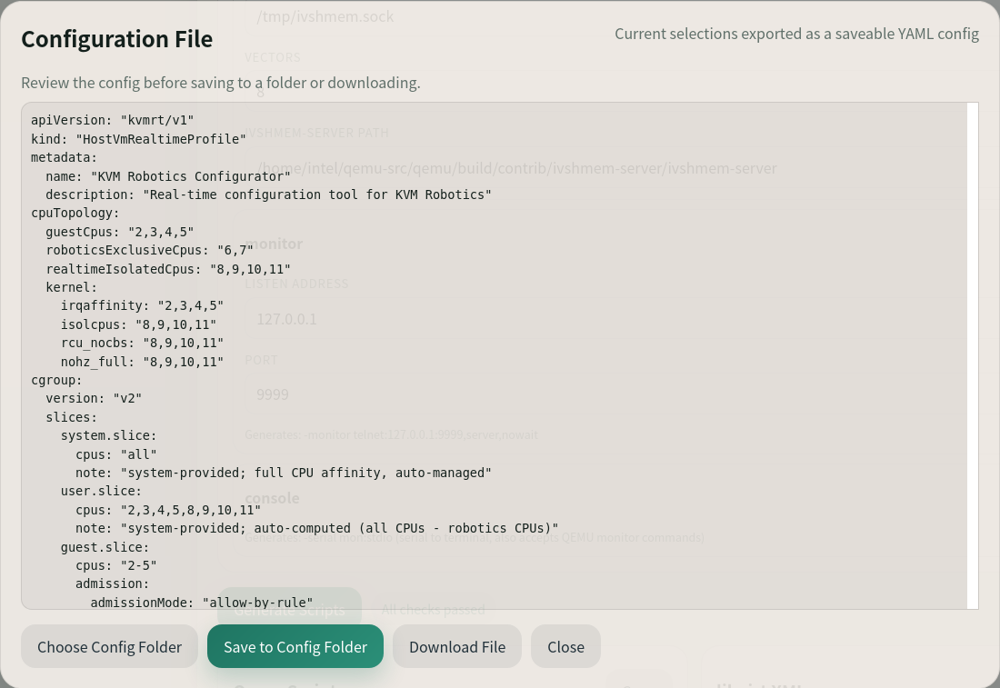

The exported YAML is suitable for review and recordkeeping.

The welcome page also provides an option to select a YAML file from the target host. After import, the workspace displays the imported file name and preserves the imported file's original content in the exported YAML.

## Frequently Asked Questions

### The CPU List Cannot Be Loaded or Core Types Show Unknown

Confirm that the service is running on the target Linux host and that CPU/sysfs information is readable. Hybrid core detection may depend on CPUID or sysfs support. Do not infer the host's topology from example CPU IDs.

### Real-Time Configuration Dry Run or Apply Fails

Check for conflicting CPU assignments, backend errors, execution permissions, and bootloader support on the target system. Confirm that the boot parameter update method is appropriate for the host, and back up the relevant boot configuration before applying.

### VM Generation Is Blocked by Missing CPU Topology CMDLINE/GRUB Files

Review CPU groups in CPU Topology, then run the real-time configuration workflow to generate the required boot configuration. Return to VM setting and generate again. Verify the target host and bootloader configuration before applying.

### Hugepage Validation Fails

Confirm that the Hugepage count matches VM memory and that the host has enough memory available for reservation. After changing boot parameters, check that they were written successfully, save your work, and restart the Linux host.

### PCI or Network Devices Are Unavailable in the Guest

Check PCI addresses, VFIO/IOMMU configuration, device dependencies, Bridge/TAP names, MAC addresses, and paths referenced by the generated files. Passthrough may detach devices from the Host; if needed, remove the devices from the VM configuration and restore the host drivers.
