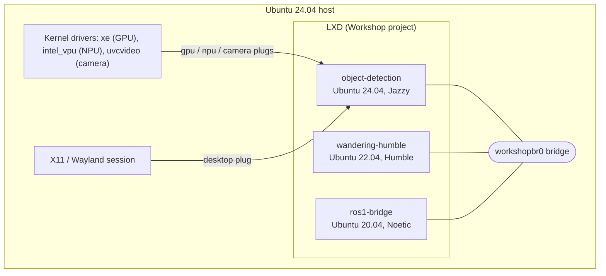

<!--
Copyright (C) 2026 Intel Corporation

SPDX-License-Identifier: Apache-2.0
-->

# How Workshops Work

This page explains how the Robotics AI Suite workshops are built, and how to add a workshop for another component. For Workshop itself, see the [Canonical Workshop documentation](https://ubuntu.com/workshop/docs/).

## Overview



Each workshop is an LXD system container managed by Workshop. Its user space follows the definition's `base`, which sets the Ubuntu release and with it the ROS 2 distribution, but it runs on the host's kernel and kernel drivers. Devices and the desktop reach the container through Workshop interfaces, called plugs. All workshops and the host share the `workshopbr0` network bridge, so ROS 2 discovery works between them.

## Workshop definitions

A workshop is defined by a YAML file in a project directory. For a component, the project directory is `src/components/<component>/workshop/`:

```text
src/components/<component>/workshop/
  .workshop/
    <name>.yaml           Ubuntu 24.04, ROS 2 Jazzy
    <name>-humble.yaml    Ubuntu 22.04, ROS 2 Humble
    proxy, robotics-ai-suite, ...   Symbolic links to the shared SDKs
  apt-packages.txt        The component's packages
  *_check.py, *.rviz, patches/      Helpers used by the actions
  README.md
```

The project directory is mounted read-write in the container at `/project`, so actions can use the helper scripts and configuration files in it.

A definition names the workshop, its base, the SDKs that set it up, and its actions:

```yaml
name: its-planner
base: ubuntu@24.04
sdks:
  - name: project-proxy
  - name: project-robotics-ai-suite
actions:
  plan-check: |
    source /opt/ros/*/setup.bash
    ...
```

## SDKs

An SDK is a reusable part of a workshop: a directory with an `sdk.yaml` file that declares its plugs, and optional hooks that install software. The definitions list them as `project-<name>`, which Workshop resolves to `.workshop/<name>/`. In this repository those are symbolic links to [`src/workshops/sdks/`](https://github.com/open-edge-platform/robotics-ai-suite/tree/main/src/workshops/sdks), so every workshop shares one copy.

| SDK | Plugs | What it installs | Used by |
|---|---|---|---|
| `proxy` | - | The host's proxy settings for apt, `/etc/environment`, curl, wget, cargo and dirmngr. Does nothing on a direct connection | All workshops, listed first |
| `robotics-ai-suite` | `gpu`, `npu`, `desktop` | The Robotics AI Suite with robotics-installer, then the workshop's `apt-packages.txt` | All ROS 2 workshops |
| `intel-accel` | `gpu`, `npu` | GPU and NPU user-space drivers and tools (`clinfo`, `vainfo`, `qmassa`) | accel-check |
| `camera` | `camera` | Nothing; declares the camera plug only | RealSense™ Camera, Multi-camera AI Demo |
| `docker` | - | Docker and Docker Compose inside the workshop | Robotics System Profiler |
| `ros1-bridge` | - | ROS 1 Noetic, ROS 2 Foxy and `ros1_bridge` from packages.ros.org (Ubuntu 20.04 only) | ROS 1 Bridge |
| `ros2` | `gpu`, `npu`, `desktop` | ROS 2 Lyrical from packages.ros.org and the GPU compute runtime (Ubuntu 26.04 only) | Robotics System Profiler on Lyrical |

SDKs are installed in the order listed. `setup-base` hooks run as root; `setup-project` hooks run as the `workshop` user, after the plugs connect automatically. The suite installer runs in `setup-project`, so its preflight check can see the GPU.

### The robotics-ai-suite SDK

The SDK picks the ROS 2 distribution and installer profile from the definition's base:

| `base` | ROS 2 | Installer profile |
|---|---|---|
| `ubuntu@24.04` | Jazzy | `complete` |
| `ubuntu@22.04` | Humble | `full` |

It downloads robotics-installer, verifies its SHA-256 checksum, and runs it unattended. It then installs the packages in the workshop's `apt-packages.txt`: one package per line, with `#` comments allowed and `${ROS_DISTRO}` expanded. The list is installed on every build, so to add a package, add it to the list and run `workshop refresh <name>`.

Ubuntu 26.04 is not yet supported by robotics-installer or the Intel® AMR and OpenVINO™ apt repositories, so workshops on `ubuntu@26.04` use the `ros2` SDK instead. It skips, with a message, any entry in `apt-packages.txt` that apt doesn't know.

## Device interfaces

| Plug | Interface | Gives the container | Connects |
|---|---|---|---|
| `gpu` | `gpu` | `/dev/dri/card*` and `/dev/dri/renderD*` | Automatically |
| `npu` | `custom-device` (subsystem `accel`) | `/dev/accel/accel*` | Manually: `workshop connect <name>/<sdk>:npu :custom-device` |
| `desktop` | `desktop` | The host's X11 or Wayland display, for RViz and Gazebo | Manually: `workshop connect <name>/robotics-ai-suite:desktop` |
| `camera` | `camera` | `/dev/video*` and `/dev/media*`, with hot-plug | Manually: `workshop connect <name>/camera:camera` |

Workshop resolves the GPU and the display when the plug is connected. If either changes on the host, for example a reboot that renumbers the GPU or a new X display after logging in again, reconnect the plug. See [Troubleshooting](troubleshooting.md).

## Jazzy and Humble pairs

Every ROS 2 workshop has two definitions that differ only in `name` and `base`. To keep them otherwise identical:

- Actions use `$ROS_DISTRO` or `/opt/ros/*/setup.bash`, never a distribution name.
- `apt-packages.txt` names packages as `ros-${ROS_DISTRO}-...`.
- Both definitions share the project directory, so they share `/project` and its helper scripts.

See [ROS Distributions and Interoperability](ros-distros.md) for Humble results and known issues.

## Actions

Actions are shell snippets in the definition, run with `workshop run <name> <action> [args]`. Arguments arrive as `$1`, `$2` and so on. Workshop reads actions from the definition each time they run, so editing an action needs no refresh.

The actions in these workshops follow some conventions:

- Actions that open a window check the X display first. If it can't be opened, they print the commands to reconnect the desktop plug.
- Headless check actions, named `*-check`, print PASS or FAIL and return non-zero on failure, so they can be used in scripts.
- Actions don't read `~/.bashrc`, so `ROS_DOMAIN_ID` is unset (domain 0) unless the action sets it.
- Background processes started inside an action stop when the action ends. To run two sides at once, start two `workshop run` commands from the host.

## Networking

All workshops sit on the `workshopbr0` LXD bridge together with the host. ROS 2 discovery reaches across it, so workshops on the same `ROS_DOMAIN_ID` see each other's topics, and the host can join them. The container's hostname is the workshop name. See [ROS 2 from the host](ros-distros.md#ros-2-from-the-host).

## What a refresh keeps

`workshop refresh <name>` applies changes to the definition or its SDKs:

- Changes to actions need no refresh.
- A change to an SDK (its hooks, plugs or `sdk.yaml`) rebuilds the container. For the suite, that runs the full installer again, about 10 to 12 minutes.
- A rebuild keeps manually connected plugs, but discards anything built or configured inside the container. Examples are the `~/ov_ws` overlay from the Object Detection tutorial's `build-npu-fix` action, and SSH pairing for the Robotics System Profiler. Repeat those steps after a rebuild.
- `workshop restore` resets the container to its last launch or refresh, and also resets interface connections. Reconnect the NPU and the desktop afterwards.

## Add a workshop for another component

1. Create the workshop directory next to the component's source, and link the shared SDKs:

   ```bash
   mkdir -p src/components/my-component/workshop/.workshop
   cd src/components/my-component/workshop/.workshop
   ln -s ../../../../workshops/sdks/proxy proxy
   ln -s ../../../../workshops/sdks/robotics-ai-suite robotics-ai-suite
   ```

2. List the component's packages in `src/components/my-component/workshop/apt-packages.txt`, for example `ros-${ROS_DISTRO}-my-component`.

3. Write `.workshop/my-component.yaml`:

   ```yaml
   # Copyright (C) 2026 Intel Corporation
   #
   # SPDX-License-Identifier: Apache-2.0

   name: my-component
   base: ubuntu@24.04
   sdks:
     - name: project-proxy
     - name: project-robotics-ai-suite
   actions:
     demo: |
       source /opt/ros/*/setup.bash
       ros2 launch my_component demo.launch.py
   ```

4. Copy it to `.workshop/my-component-humble.yaml`, and change `name` to `my-component-humble` and `base` to `ubuntu@22.04`.

5. Launch both. Add a headless `*-check` action that prints PASS or FAIL and returns non-zero on failure.

6. Add a `README.md` to the workshop directory, and a tutorial page to this section of the documentation.

7. Give every new file a REUSE license header, or cover it in the component's `REUSE.toml`; component CI runs `make license-check`.

To copy a single workshop elsewhere, use `cp -rL` so that the SDKs come along as real files instead of links.
