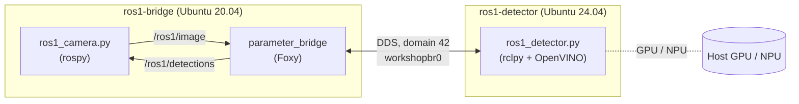

<!--
Copyright (C) 2026 Intel Corporation

SPDX-License-Identifier: Apache-2.0
-->

# ROS 1 Bridge Workshop

This tutorial connects a ROS 1 Noetic application to Robotics AI Suite inference on ROS 2 Jazzy, through `ros1_bridge`. The suite supports only ROS 2, and Noetic and `ros1_bridge` packages exist only for Ubuntu 20.04, so the tutorial uses two workshops:

| Workshop | Base | Runs |
|---|---|---|
| `ros1-bridge` | Ubuntu 20.04 | ROS 1 Noetic (`roscore` and a camera node) and the ROS 2 Foxy `ros1_bridge`, from packages.ros.org |
| `ros1-detector` | Ubuntu 24.04 | The Robotics AI Suite on Jazzy, and the object detection tutorial's SSD model with OpenVINO™ on the CPU, GPU or NPU |



The ROS 1 camera node publishes a raw RGB frame (`sensor_msgs/Image`) at a fixed rate. The bridge carries it to ROS 2, where the detector runs SSD MobileNet v2 and publishes the detections as JSON (`std_msgs/String`). The bridge carries them back, and the camera node measures the round trip for each frame.

## Prerequisites

- A host set up as described in [Getting Started](getting-started.md).

## Launch the workshops

1. Launch both workshops. `ros1-bridge` takes about 2 minutes; `ros1-detector` installs the full suite and takes about 11 minutes:

   ```bash
   cd src/workshops/ros1-bridge
   workshop launch ros1-bridge
   workshop launch ros1-detector
   ```

   Workshop warns that Ubuntu 20.04 bases are no longer supported. Acknowledge the warning with `workshop okay`; see [Known issues](#known-issues).

2. To run detection on the NPU, connect it to the detector:

   ```bash
   workshop connect ros1-detector/robotics-ai-suite:npu :custom-device
   ```

## Run the round trip

The check script runs both sides from the host, and prints PASS if at least 95% of the frames get their detections back:

```bash
cd ..
./scripts/ros1-bridge-check.sh                      # GPU, 640 x 480 at 10 Hz, for 30 s
./scripts/ros1-bridge-check.sh NPU 1280 720 30 30   # NPU, 1280 x 720 at 30 Hz, for 30 s
```

Its arguments are:

```text
scripts/ros1-bridge-check.sh [device] [width] [height] [hz] [seconds] [rmw]
```

| Argument | Default | Description |
|---|---|---|
| `device` | `GPU` | `CPU`, `GPU` or `NPU` |
| `width`, `height` | `640`, `480` | Frame size. The frame is generated on first use |
| `hz` | `10` | Publish rate |
| `seconds` | `30` | Measured time, after an 8-second warm-up |
| `rmw` | `rmw_cyclonedds_cpp` | ROS 2 middleware on both sides. `rmw_fastrtps_cpp` also works |

## Example results

:::{note}
Individual results may vary.
:::

On an Intel® Core™ Ultra X7 358H processor with Cyclone DDS, every run answered 100% of the frames, with the same labels (bicycle, car):

| Input | Device | Round trip, median | Round trip, 90th percentile | Resize and inference, median |
|---|---|---|---|---|
| 640 x 480 at 10 Hz | GPU | 4.7 ms | 5.3 ms | 1.68 ms |
| 1280 x 720 at 30 Hz | NPU | 10.8 ms | 12.2 ms | 3.83 ms |
| 1280 x 720 at 30 Hz | GPU, Fast DDS | 11.5 ms | 15.7 ms | 1.77 ms |

Latencies vary between runs; repeated GPU runs at 640 x 480 and 10 Hz gave a median round trip of 4.7 to 8.4 ms. Compare devices from runs made back to back. Compared with running the camera on ROS 2 in the same workshop as the detector, the bridge adds about 2 to 4 ms per round trip.

## Run each side by hand

The check script uses these actions. To run them yourself, use two terminals, and start the detector first:

| Workshop | Action | Description |
|---|---|---|
| `ros1-detector` | `frames [width] [height]` | Writes the tutorial's `coco_bike.jpg` as a raw RGB frame to `ros1-bridge/frames/` |
| `ros1-detector` | `detect [device] [max_seconds] [rmw]` | The detector on ROS 2 domain 42. Prints `ready` once the model is compiled, and exits 5 seconds after the last frame |
| `ros1-bridge` | `bridge-detect [width] [height] [hz] [seconds] [rmw]` | `roscore`, `parameter_bridge` for `/ros1/image` and `/ros1/detections`, then the ROS 1 camera node. Returns 1 if fewer than 95% of frames are answered |

## Design notes

- **`parameter_bridge`, not `dynamic_bridge`.** `dynamic_bridge` crashes when it reads the graph information of Jazzy nodes. `parameter_bridge` bridges a fixed list of topics, set with `rosparam set /topics`, and works.
- **ROS 2 Foxy for the bridge.** `ros-foxy-ros1-bridge` is the only packaged `ros1_bridge`; there is no package for Humble or Jazzy. Both Cyclone DDS and Fast DDS carry `sensor_msgs/Image` and `std_msgs/String` between Foxy and Jazzy. Types whose definitions changed between Foxy and Jazzy may not work; see [Humble and Jazzy on the same domain](ros-distros.md#humble-and-jazzy-on-the-same-domain) for the same effect between Humble and Jazzy.
- **ROS domain 42.** Both sides use `ROS_DOMAIN_ID=42`, so the loop doesn't mix with other workshops on the default domain 0.
- **Cyclone DDS configuration.** The detector unsets `CYCLONEDDS_URI`, because the suite sets it to a file that doesn't exist; see [Troubleshooting](troubleshooting.md#cyclone-dds-fails-to-start-in-a-jazzy-workshop).
- **Resize on the CPU.** The detector resizes frames with OpenCV. With OpenVINO™'s embedded resize, the NPU returns no detections; this is the same problem as in the [Object Detection](object-detection.md#known-issues) workshop.
- **Consumers on the host.** A ROS 2 node on the host that uses Cyclone DDS needs the `ros1-bridge` workshop's IP address as a unicast peer to see the bridged topics.

## Known issues

- **Ubuntu 20.04 base.** Workshop launches it, but warns that 20.04 bases are no longer supported and will need 22.04 or later before its next release. Noetic and `ros1_bridge` packages exist only for 20.04, and Noetic and Foxy are both end of life. If Workshop drops 20.04 bases, the alternative is [ROS-O](https://ros.packages.techfak.net/), Noetic-based ROS 1 packages for Ubuntu 22.04 and 24.04, with a bridge built from source.

## Source

The definitions, nodes and package list are in [`src/workshops/ros1-bridge/`](https://github.com/open-edge-platform/robotics-ai-suite/tree/main/src/workshops/ros1-bridge). The check script is [`src/workshops/scripts/ros1-bridge-check.sh`](https://github.com/open-edge-platform/robotics-ai-suite/blob/main/src/workshops/scripts/ros1-bridge-check.sh).
