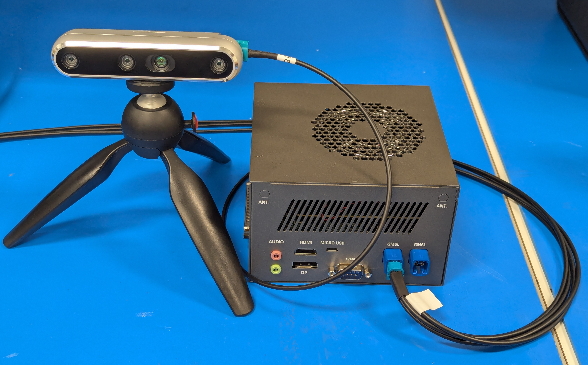
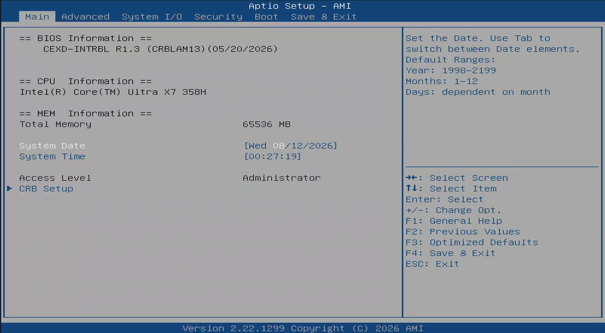
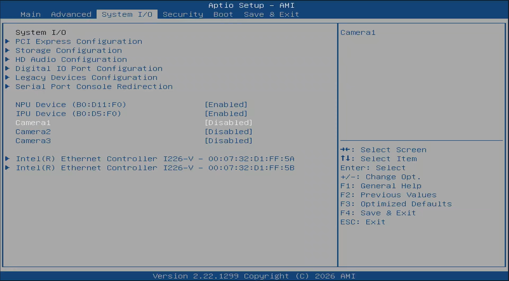

# GMSL

This guide covers connecting and configuring a GMSL camera using the AAEON CEXD-INTRBL FAKRA ports. Use of this interface requires software setup, including installing the Robotics AI Suite. Make sure you've followed the [Getting Started](../../../getting_started.md) guide.

## Physical Connection

The AAEON CEXD-INTRBL development kit includes a built-in GMSL connector board. You can see two FAKRA connectors exposed on the external housing. These support up to 8 connections, split between both ports.

For RealSense D457 GMSL cameras, connect a maximum of 2 cameras to each GMSL 4-in-1 FAKRA port. This optimizes bandwidth for the multi-sensor devices. Additional connections for this camera is not currently supported by Robotics AI Suites, and may not be supported by the manufacturer.

## BIOS Configuration

GMSL cameras are described by an ACPI SSDT overlay instead of the BIOS. The
BIOS camera settings create ACPI camera devices that conflict with the overlay,
so all of them must be disabled.

Open the `System IO` menu in the BIOS.

Set `Camera1`, `Camera2` and `Camera3` to `Disabled`, then save and exit.

## Next steps

Once all BIOS camera settings are disabled, continue with [GMSL Camera Setup with ACPI SSDT Overlay](../../../../components/sensors/cameras/gmsl/index.md).
