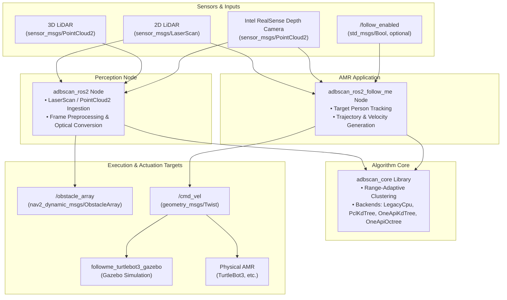

<!--
Copyright (C) 2026 Intel Corporation

SPDX-License-Identifier: Apache-2.0
-->

# ADBSCAN (Adaptive Density-Based Spatial Clustering of Applications with Noise)

## Documentation

Comprehensive documentation on this component is available here: [dev guide](https://developer.robotics.intel.com/development-stack/components/optimized_solutions/adbscan-follow-me/)

## Overview

ADBSCAN (Adaptive Density-Based Spatial Clustering of Applications with Noise) is an Intel-patented unsupervised clustering algorithm that groups spatial point cloud data based on range-adaptive density. Unlike standard DBSCAN—which uses fixed clustering radius ($\epsilon$) and point density thresholds ($MinPts$)—ADBSCAN dynamically scales these parameters relative to sensor distance. This compensates for point cloud beam divergence and sparsity at longer ranges, improving object detection range by 20–30% on average and making it particularly well suited for LiDAR and depth camera processing on Autonomous Mobile Robots (AMRs).

### What This Repository Provides

This repository provides both the core ADBSCAN clustering library, the standalone ROS 2 perception node, and a self-contained "Follow-Me" AMR reference application with simulation assets:

1. **Core Clustering Library (`adbscan_core`)**
   - Lightweight, standalone C++ library implementing range-adaptive DBSCAN (`cluster` and `cluster_frame`).
   - Supports multiple neighbor-search backends: `legacy_cpu`, `pcl_kdtree`, and hardware-accelerated SYCL `oneapi_kdtree` and `oneapi_octree`.
   - Independent of ROS message types, optical transforms, and middleware.
   - See the [C++ Developer Integration Guide](src/adbscan_core/DEV_GUIDE.md) for CMake integration, code examples, and sensor parameter tuning.

2. **Perception & Spatial Clustering (`adbscan_ros2`)**
   - Ingests 2D LiDAR (`sensor_msgs/LaserScan`), 3D LiDAR (`sensor_msgs/PointCloud2`), or Intel® RealSense™ depth data.
   - Computes range-adaptive bounding boxes and clusters in real time using `adbscan_core`.
   - Publishes segmented obstacles using `nav2_dynamic_msgs::msg::ObstacleArray`.
   - The [nav2_dynamic_msgs](src/nav2_dynamic_msgs/README.md) package in this repository maintains the `Obstacle` and `ObstacleArray` interfaces.

3. **AMR Reference Application (`adbscan_ros2_follow_me`)**
   - Self-contained target follower tracking cluster centroids using `adbscan_core`.
   - Publishes differential-drive navigation commands (`geometry_msgs/msg/Twist`).
   - Supports 2D LiDAR and RealSense depth tracking with optional runtime `/follow_enabled` boolean activation.

4. **Simulation, Deployment, and Verification**
   - `followme_turtlebot3_gazebo`: Gazebo simulation environments (Harmonic / Fortress) for TurtleBot3 with an autonomous wandering guide robot.
   - Launch files and configurations for AMR platforms and sensors (RPLidar, RealSense D435/D455).
   - Automated synthetic headless E2E testing with pytest and ROS 2 launch testing.

5. **Experimental Multi-Modal Interaction Packages**
   - `gesture_recognition_pkg`, `speech_recognition_pkg`, `text_to_speech_pkg`, and `follow_me_interfaces`: Prototype OpenVINO™ interaction nodes preserved for reference, not required for core following.

### Architecture



### Supported Sensor Modalities & Target Platforms

- **Sensor Types**: 2D LiDAR, 3D LiDAR, Intel® RealSense™ Depth Cameras (D435, D455)
- **Actuation**: Differential drive robots (`cmd_vel`)
- **Operating Systems & ROS 2 Distros**:
  - Ubuntu 22.04 LTS (ROS 2 Humble)
  - Ubuntu 24.04 LTS (ROS 2 Jazzy)

## Getting Started

### System Requirements

Prepare the target system following the [official documentation](https://developer.robotics.intel.com/development-stack/platform_foundation/getting_started/).

### Environment Setup & Prerequisites

1. **Verify Developer Tooling**:
   Ensure required build tools (`ninja`, `colcon`, `docker`, `python3`) and linters are present on the host:

   ```bash
   make tools-check
   ```

2. **Select and Source ROS 2 Distribution**:

   ```bash
   # For Ubuntu 24.04 (Jazzy)
   export ROS_DISTRO=jazzy
   source /opt/ros/jazzy/setup.bash  # or setup.zsh for Zsh

   # For Ubuntu 22.04 (Humble)
   export ROS_DISTRO=humble
   source /opt/ros/humble/setup.bash  # or setup.zsh for Zsh
   ```

3. **Install Package Build Dependencies**:
   Generate Debian control files and install required build dependencies via APT:

   ```bash
   make debian-build-deps
   sudo make install-debian-build-deps
   ```

   *(Requires `devscripts`, `equivs`, and `dpkg-dev`).*

---

### Workflow A: Local Source Development (Colcon)

Use this workflow to build, iterate, and run packages directly from the repository source:

1. **Build Packages**:

   ```bash
   make build
   ```

   This executes `colcon build --symlink-install` across all packages declared in [robotics-project.json](robotics-project.json), creating build artifacts in `build/` and symlinks in `install/`.

2. **Source the Workspace Overlay**:

   ```bash
   source install/setup.bash  # or setup.zsh for Zsh
   ```

3. **Verify Package Availability**:

   ```bash
   ros2 pkg list | grep -E 'adbscan|follow'
   ```

---

### Workflow B: Debian Package Creation & System Installation

Use this workflow to generate release Debian packages (`.deb`) via CMake and CPack:

1. **Build Debian Packages**:

   ```bash
   make package
   ```

   Package builds are CPU-only by default for Humble. Jazzy enables Intel®
   oneAPI™ SYCL acceleration by default and requires the oneAPI compiler and
   development packages:

   ```bash
   make package ROS_DISTRO=jazzy
   ```

   Use `WITH_ONEAPI=OFF` to build CPU-only Jazzy packages. The oneAPI package
   build is verified on Jazzy; on the current Humble build image, `icpx` 2026.1
   fails compiling ROS2 against PCL's Boost.MPL headers.

   Native `.deb` packages will be placed into `build/debian-packages/packages/`:

   ```bash
   ls build/debian-packages/packages/*.deb
   ```

   ```text
   ros-jazzy-adbscan-core_0.1.0-2_amd64.deb
   ros-jazzy-nav2-dynamic-msgs_0.0.1-1_amd64.deb
   ros-jazzy-adbscan-ros2_2.3-4_amd64.deb
   ros-jazzy-adbscan-ros2-follow-me_2.3-4_amd64.deb
   ros-jazzy-followme-turtlebot3-gazebo_2.3-5_amd64.deb
   ```

2. **Install Built Debian Packages**:

   ```bash
   sudo apt update
   sudo apt install -y ./build/debian-packages/packages/*.deb
   ```

   Keep the AMR, ROS 2, and Intel oneAPI APT repositories configured when
   installing the bundle. The AMR repository's PCL packages can depend on Intel
   compiler runtimes even when ADBSCAN is built with `WITH_ONEAPI=OFF`; this
   does not enable accelerated clustering. OneAPI execution additionally needs
   a supported device runtime and drivers.

---

### Cleaning Build Artifacts

To clean up all local build, install, log, coverage, and package artifacts:

```bash
make clean
```

## Testing and Verification

The repository employs a multi-tiered testing strategy to validate algorithm correctness, node communication, and test coverage before deployment.

### 1. Colcon Unit & Algorithmic Tests

- **What is tested**: Core clustering algorithms, bounding box calculations, and mathematical utility functions via Google Test (`gtest`).
- **Why we test it**: To verify that the ADBSCAN adaptive clustering logic deterministically partitions point clouds into expected clusters and does not regress.
- **How to run**:

  ```bash
  ROS_DISTRO=jazzy make test
  ```

  *(Builds with `-DBUILD_TESTING=ON`, executes all package-level unit tests sequentially, and returns non-zero on test failures).*

### 2. End-to-End (E2E) Headless Launch Tests

- **Test prerequisites**: On a minimal package-only installation, install the
  launch-test tools separately; they are not application runtime dependencies:

  ```bash
  sudo apt install python3-pytest ros-${ROS_DISTRO}-launch-testing-ros \
    ros-${ROS_DISTRO}-sensor-msgs-py
  ```

- **What is tested**: Full ROS 2 node lifecycle and topic publication using `launch_testing` and `pytest` ([tests/test_adbscan_topic_publication.py](tests/test_adbscan_topic_publication.py)).
- **Why we test it**: Algorithmic tests run in isolation; E2E launch tests verify that the actual node executables (`adbscan_pub`) spin up cleanly in the ROS graph and advertise expected topics (`/Obstacle_Array` with type `nav2_dynamic_msgs/msg/ObstacleArray`).
- **How to run**:

  ```bash
  ROS_DISTRO=jazzy make test-e2e
  ```

  Results are recorded to `testout/adbscan_e2e.xml`.

### 3. C++ Code Coverage Analysis

- **What is tested**: Line and branch coverage across C++ source files under `src/` (excluding third-party code and build artifacts).
- **Why we test it**: To monitor test thoroughness, identify untested branches in clustering heuristics, and track code quality over time.
- **How to run**:

  ```bash
  ROS_DISTRO=jazzy make coverage
  ```

  *(Requires `gcovr` and `uv`).* Generates an interactive HTML report at `testout/coverage/index.html` and an XML report at `testout/coverage/coverage.xml`.

### 4. Test Result Reporting

- **What is tested**: Aggregates and parses XML test artifacts from `build/*/test_results/`.
- **Why we test it**: Produces a standardized markdown summary for developer inspection and CI workflow status checks.
- **How to run**:

  ```bash
  ROS_DISTRO=jazzy make test-results
  ```

  Outputs summary to `testout/test-summary.md`.

### 5. Release Package Verification

The release matrix has been exercised using the live AMR repository's PCL
`1.15.1-2` and, for Jazzy acceleration, FLANN OneAPI `1.9.2-1`:

| Profile | Source unit results | Installed SDK consumer | Installed ROS launch tests |
| --- | --- | --- | --- |
| Humble, CPU-only | 39 tests, 0 failures, 3 skipped | 18 passed | Passed |
| Jazzy, OneAPI on SYCL CPU | 39 tests, 0 failures, 4 skipped | 18 passed | Passed with each perception backend |
| Jazzy, OneAPI on SYCL GPU | 27 tests, 0 failures, 4 skipped | 18 passed | Passed |

The standalone OneAPI parity suite also passed all 27 enabled tests from both
the source build and the installed Jazzy libraries. Both ROS launch tests accept
`ADBSCAN_TEST_BACKEND` to select an optional backend; without it, the follower
launch test retains its configured default CPU backend.

For package verification, install all five generated packages into fresh
Ubuntu 22.04/24.04 containers with the required APT repositories configured.
Before adding test tools, check shared-library resolution, `ros2 run` startup,
and `ros2 launch followme_turtlebot3_gazebo follow_me.launch.py sensor:=realsense --show-args`.
Then install the separate test prerequisites described above, build an external
CMake consumer against `adbscan_core::adbscan_core`, and run the launch tests
against the installed nodes. Source only `/opt/ros/<distro>/setup.bash`; do not
mount a workspace overlay or source the oneAPI developer environment.

The CPU validation above does not certify a complete Gazebo simulation or
recorded/live RealSense behavior. The recorded RealSense test remains skipped
without its external fixture; the existing RealSense tuning is unchanged.

#### GPU Execution Follow-up

The installed Jazzy bundle was also exercised on an Intel Panther Lake GPU
(`8086:b0a0`), using the host's `xe` driver and a container with
`/dev/dri/renderD128` exposed. The Kobuk PPA
(`ppa:kobuk-team/intel-graphics`) provided GPU userspace drivers
`26.31.39395.16-1~24.04~ppa1` and Level Zero loader `1.32.0-1~24.04~ppa1`.

With `ONEAPI_DEVICE_SELECTOR=level_zero:gpu`, the standalone parity suite passed
27/27 tests, the installed SDK consumer passed 18/18, and both perception and
follower launch tests passed with `oneapi_kdtree` and `oneapi_octree`. The default
CPU launch tests also passed after adding optional follower backend selection.

Initialize the installed oneAPI environment before GPU execution:

```bash
source /opt/ros/jazzy/setup.bash
source /opt/intel/oneapi/setvars.sh
export ONEAPI_DEVICE_SELECTOR=level_zero:gpu
```

A follow-up using this standard setup passed all 27 parity tests and the
perception/follower octree launch tests without manually modifying library
paths. The setup script supplies the required runtime paths, including UMF.

## Development and Quality Assurance

The codebase enforces strict code formatting, linting, licensing, and CI standards to maintain repository health and prevent regressions.

### Source Formatting

Before committing changes, apply standard automated formatting across C/C++, Python, and Markdown files:

```bash
make format
```

This runs:

- `clang-format` on C/C++ files using the ROS 2 Jazzy rules defined in [.clang-format](.clang-format).
- `ruff format` and `ruff check --fix` on Python scripts following [.ruff.toml](.ruff.toml).
- `markdownlint` (or `markdownlint-cli2` if unavailable) with `--fix` on Markdown documents using [.github/linters/.markdown-lint.yml](.github/linters/.markdown-lint.yml).

### Linters & Static Analysis

Validate code quality and syntax across tracked repository files:

```bash
make lint
```

You can also run individual linters targeting specific languages or files:

| Target | Tool | Scope / Rules |
| --- | --- | --- |
| `make lint-clang-format` | `clang-format` | C/C++ formatting validation against [.clang-format](.clang-format) |
| `make lint-ruff` | `ruff` | Python linting and code style against [.ruff.toml](.ruff.toml) |
| `make lint-bash` | `shellcheck` | Bash script error and syntax checking |
| `make lint-yaml` | `yamllint` | YAML formatting against [.github/linters/.yaml-lint.yml](.github/linters/.yaml-lint.yml) |
| `make lint-json` | `python3 -m json.tool` | JSON syntax validation (e.g., [robotics-project.json](robotics-project.json)) |
| `make lint-markdown` | `markdownlint` or `markdownlint-cli2` | Markdown document rules via [.github/linters/.markdown-lint.yml](.github/linters/.markdown-lint.yml) |
| `make lint-actionlint` | `actionlint` | GitHub Actions workflow syntax via [.github/linters/actionlint.yml](.github/linters/actionlint.yml) |

### License Compliance (REUSE)

All source files require proper copyright and SPDX-License-Identifier headers. Run the containerized REUSE tool to verify compliance:

```bash
make license-check
```

### Pre-push and CI Validation

Before pushing branches or opening a Pull Request:

1. **Local Pre-Push Verification**:

   ```bash
   make check
   ```

   Runs `lint` and `license-check`.

2. **Multi-Distro Packaging & Test Verification**:

   ```bash
   make check-ci
   ```

   Validates package creation (`make package`) and test execution (`make test`) across both Ubuntu 22.04 (Humble) and Ubuntu 24.04 (Jazzy).

3. **Source Packaging**:

   ```bash
   make source-package
   ```

   Generates a clean source archive (`adbscan-<version>.zip`) from HEAD, excluding build artifacts and temporary files.

### Makefile Target Reference

Run `make help` to inspect available development targets:

```bash
make help
```

## Usage and Documentation

### Quickstart: Running Nodes and Demos

Ensure your workspace environment is active (`source install/setup.bash` or `setup.zsh`).

#### 1. Run the ADBSCAN Clustering Node

Launch the core clustering node configured for 2D LiDAR or Intel® RealSense™:

```bash
# For live 2D LiDAR input
ros2 run adbscan_ros2 adbscan_sub --ros-args --params-file "$(ros2 pkg prefix adbscan_ros2)/share/adbscan_ros2/config/adbscan_sub_2D.yaml"

# For live Intel RealSense depth camera input
ros2 run adbscan_ros2 adbscan_sub --ros-args --params-file "$(ros2 pkg prefix adbscan_ros2)/share/adbscan_ros2/config/adbscan_sub_RS.yaml"
```

Verify that segmented obstacle clusters are being published:

```bash
ros2 topic echo /Obstacle_Array
```

#### 2. Run the Follow-Me Gazebo Simulation

Launch the TurtleBot3 follower in Gazebo with a wandering guide robot:

```bash
ros2 launch followme_turtlebot3_gazebo follow_me.launch.py
# Or use the simulated depth camera:
ros2 launch followme_turtlebot3_gazebo follow_me.launch.py sensor:=realsense
```

---

### Documentation Index

Detailed documentation, launch options, and hardware deployment guides are organized as follows:

#### Package Guides

- [src/adbscan_core/DEV_GUIDE.md](src/adbscan_core/DEV_GUIDE.md) — Integration guide for consuming `adbscan_core` in external codebases (CMake, C++ examples, sensor baselines).
- [src/adbscan_core/README.md](src/adbscan_core/README.md) — Standalone C++ clustering library API (`cluster`, `cluster_frame`) and oneAPI build options.
- [src/nav2_dynamic_msgs/README.md](src/nav2_dynamic_msgs/README.md) — Dynamic obstacle message interfaces (`Obstacle`, `ObstacleArray`) used by `adbscan_ros2` and Nav2.
- [src/adbscan_ros2/Readme.md](src/adbscan_ros2/Readme.md) — Node architecture, sensor configuration YAMLs (2D LiDAR, 3D LiDAR, RealSense), topic schemas, and RViz visualization.
- [src/adbscan_ros2_follow_me/README.md](src/adbscan_ros2_follow_me/README.md) — AMR follower node architecture, target centroid tracking, velocity generation, and `/follow_enabled` activation.
- [src/followme_turtlebot3_gazebo/README.md](src/followme_turtlebot3_gazebo/README.md) — Gazebo simulation setup (Harmonic/Fortress), robot models, spawn scripts, and launch scenarios.
- [src/follow_me_interfaces/README.md](src/follow_me_interfaces/README.md) — Custom message types (`AudioCommand`, `GestureCategory`) for multi-modal interaction.
- [src/gesture_recognition_pkg/README.md](src/gesture_recognition_pkg/README.md) — MediaPipe hand gesture recognition from camera RGB streams.
- [src/speech_recognition_pkg/README.md](src/speech_recognition_pkg/README.md) — OpenVINO QuartzNet voice command recognition.
- [src/text_to_speech_pkg/README.md](src/text_to_speech_pkg/README.md) — OpenVINO Forward Tacotron + MelGAN text-to-speech feedback.

#### Follow-Me Application & Interaction

- [docs/follow_me_readme.md](docs/follow_me_readme.md) — Follower controls, simulation options, and sensor configuration.
- [docs/follow_me_requirements.md](docs/follow_me_requirements.md) — ROS/Gazebo runtime and build dependencies.

#### Sensor & Robot Hardware Deployment

- [docs/adbscan_aaeon_robot.md](docs/adbscan_aaeon_robot.md) — Deploying ADBSCAN on physical AAEON AMR platforms.
- [docs/adbscan-realsense.md](docs/adbscan-realsense.md) — Intel® RealSense™ D435/D455 camera setup, camera drivers, and tuning.
- [docs/adbscan-rplidar.md](docs/adbscan-rplidar.md) — RPLidar hardware integration, serial configuration, and launch parameters.

#### Algorithm & Performance

- [docs/IA-optimized-adbscan-algorithm.md](docs/IA-optimized-adbscan-algorithm.md) — Mathematical formulation of range-adaptive clustering and Intel Architecture CPU vectorization optimizations.
- [Online Developer Guide](https://developer.robotics.intel.com/development-stack/components/optimized_solutions/adbscan-follow-me/) — Official Intel Edge AI Suites component documentation.

## License

`ADBSCAN` is licensed under [Apache 2.0 License](./LICENSES/Apache-2.0.txt).
