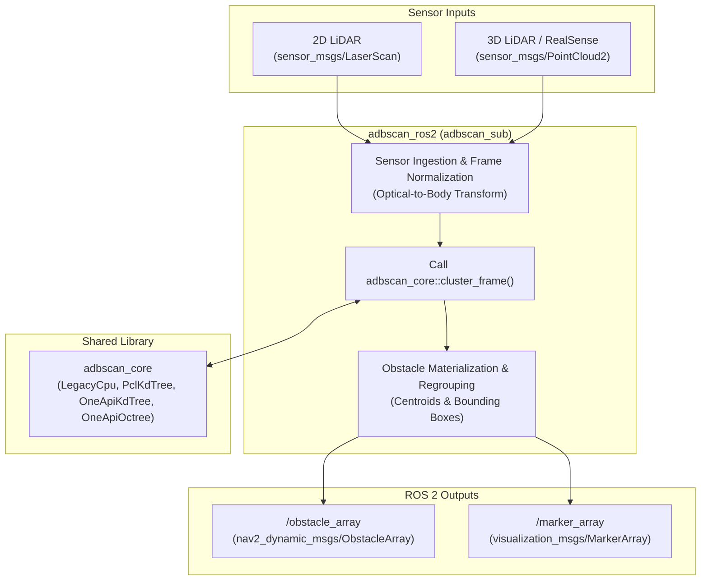

<!--
Copyright (C) 2026 Intel Corporation

SPDX-License-Identifier: Apache-2.0
-->

# ADBSCAN ROS 2 Node Documentation

The `adbscan_ros2` package provides the ROS 2 perception node (`adbscan_sub`)
that subscribes to 2D LiDAR scans or 3D/RealSense point clouds, runs
adaptive DBSCAN clustering via the `adbscan_core` library, and publishes
detected obstacles as `nav2_dynamic_msgs::msg::ObstacleArray`.

## Architecture



The node workflow consists of:

1. **Sensor Ingestion**: Subscribes to 2D LiDAR (`sensor_msgs/msg/LaserScan`) or 3D/depth point clouds (`sensor_msgs/msg/PointCloud2`). For Intel® RealSense™ depth cameras, coordinates are transformed from camera optical coordinates into the robot body coordinate frame (+X forward).
2. **Core Clustering**: Hands preprocessed Cartesian points to `adbscan_core::cluster_frame()` along with range-dependent polynomial thresholds. Search can execute on the CPU or be offloaded to Intel GPUs via oneAPI SYCL kernels.
3. **Obstacle Materialization**: Regroups clustered points into spatial obstacles, deriving bounding boxes and centroid coordinates.
4. **Publishing**: Publishes typed obstacles to `/obstacle_array` for navigation stacks (e.g., Nav2) and visual markers to `/marker_array` for RViz.

## How to Build Locally

Build the message interface, core library, and the ROS 2 node from the workspace root:

```bash
source /opt/ros/<distro>/setup.bash
colcon build --packages-select nav2_dynamic_msgs adbscan_core adbscan_ros2
```

To enable hardware-accelerated oneAPI and PCL search backends, compile with
`icpx` and `-DWITH_ONEAPI=ON`:

```bash
colcon build --packages-select nav2_dynamic_msgs adbscan_core adbscan_ros2 \
  --cmake-args -DWITH_ONEAPI=ON -DCMAKE_CXX_COMPILER=icpx
```

## How to Run the Node

Source the workspace overlay:

```bash
source install/setup.bash
```

For RealSense camera input:

```bash
ros2 run adbscan_ros2 adbscan_sub --ros-args \
  --params-file "$(ros2 pkg prefix adbscan_ros2)/share/adbscan_ros2/config/adbscan_sub_RS.yaml"
```

For 2D LiDAR input:

```bash
ros2 run adbscan_ros2 adbscan_sub --ros-args \
  --params-file "$(ros2 pkg prefix adbscan_ros2)/share/adbscan_ros2/config/adbscan_sub_2D.yaml"
```

## Node Inputs & Configuration

The input topic and sensor parameters are defined in YAML configuration files
under `src/adbscan_ros2/config/`:

- **2D LiDAR Input**:
  - **File name**: `adbscan_sub_2D.yaml`
  - **Message type**: `sensor_msgs/msg/LaserScan`
- **3D LiDAR Input**:
  - **File name**: `adbscan_sub_3D.yaml`
  - **Message type**: `sensor_msgs/msg/PointCloud2`
- **RealSense Depth Input**:
  - **File name**: `adbscan_sub_RS.yaml`
  - **Message type**: `sensor_msgs/msg/PointCloud2`

### Key Parameters

| Parameter | Type | Default | Description |
| --- | --- | --- | --- |
| `use_adbscan_core` | bool | `true` | Routes clustering through the shared `adbscan_core` library. Set `false` to roll back to the legacy direct-scan implementation. |
| `core_backend` | string | `legacy_cpu` | Neighbor-search backend for `adbscan_core`. Options: `legacy_cpu`, `pcl_kdtree`, `oneapi_kdtree`, `oneapi_octree`. Non-CPU backends require `WITH_ONEAPI=ON`. |
| `Lidar_type` | string | `2D` / `RS` / `3D` | Sensor modality profile: `2D`, `3D`, or `RS`. |
| `Lidar_topic` | string | `scan` / `/camera/depth/color/points` | Input ROS 2 topic name. |
| `subsample_ratio` | float | varies | Downsampling step for input point cloud data. |
| `x_filter_back`, `y_filter_left`, `y_filter_right`, `z_filter` | float | varies | Spatial bounding box limits for point filtering. |
| `Z_based_ground_removal` | float | `1.0` | Enables ground plane removal based on Z threshold when non-zero. |
| `base`, `coeff_1`, `coeff_2`, `scale_factor` | float | varies | Range-adaptive polynomial coefficients for radius and density thresholds. |

When using oneAPI backends (`oneapi_kdtree` or `oneapi_octree`), set the target device
using the SYCL environment variable before launching the node:

```bash
# Target Intel GPU
ONEAPI_DEVICE_SELECTOR=level_zero:gpu ros2 run adbscan_ros2 adbscan_sub --ros-args \
  --params-file "$(ros2 pkg prefix adbscan_ros2)/share/adbscan_ros2/config/adbscan_sub_RS.yaml" \
  -p core_backend:=oneapi_kdtree

# Target CPU
ONEAPI_DEVICE_SELECTOR=opencl:cpu ros2 run adbscan_ros2 adbscan_sub --ros-args \
  --params-file "$(ros2 pkg prefix adbscan_ros2)/share/adbscan_ros2/config/adbscan_sub_RS.yaml" \
  -p core_backend:=oneapi_kdtree
```

## Node Outputs

The node publishes detected obstacle bounding boxes, centroids, and visualization markers:

- **Obstacle Array**:
  - **Topic**: `/obstacle_array`
  - **Type**: `nav2_dynamic_msgs/msg/ObstacleArray` (defined in [nav2_dynamic_msgs](../nav2_dynamic_msgs/README.md))
  - Obstacle centroids, dimensions, and positions in the robot reference frame.
- **Visual Markers**:
  - **Topic**: `/marker_array`
  - **Type**: `visualization_msgs/msg/MarkerArray`
  - Bounding box and centroid markers for display in RViz2.

View the published obstacle messages:

```bash
ros2 topic echo /obstacle_array
```

## RViz Visualization

Launch RViz2 to visualize detected obstacles and point cloud markers:

```bash
rviz2
```

Add a `MarkerArray` display subscribing to the obstacle visualization topic.
