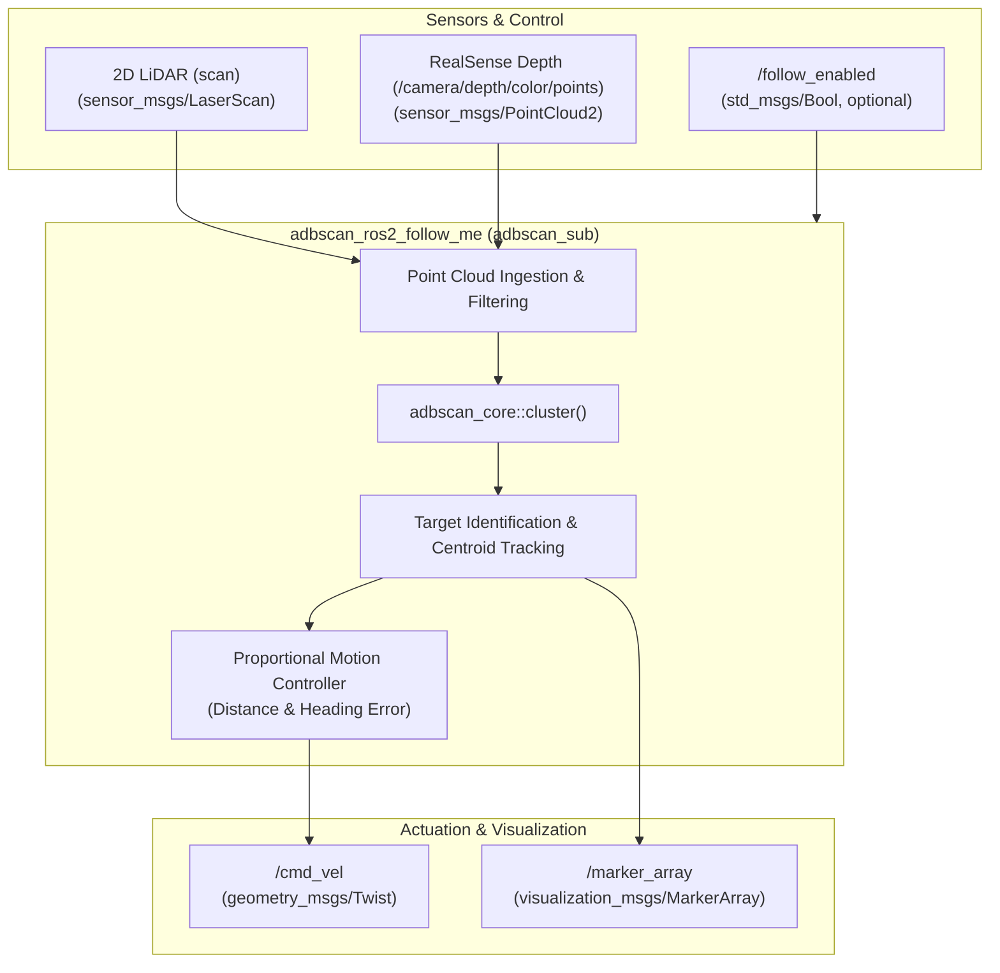

<!--
Copyright (C) 2026 Intel Corporation

SPDX-License-Identifier: Apache-2.0
-->

# ADBSCAN ROS 2 Follow-Me Package (`adbscan_ros2_follow_me`)

The `adbscan_ros2_follow_me` package provides an autonomous target-following application for Autonomous Mobile Robots (AMRs) using range-adaptive point cloud clustering powered by `adbscan_core`.

The node identifies the target person or lead guide vehicle in front of the robot, computes its spatial centroid, and generates real-time differential drive velocity commands (`cmd_vel`) to maintain a constant following distance and heading.

---

## Architecture



### Pipeline Overview

1. **Sensor Ingestion & Preprocessing**: Ingests 2D LiDAR scans or 3D RealSense depth point clouds. Applies spatial bounding box filtering, downsampling, and optional ground plane removal.
2. **Adaptive Clustering**: Passes preprocessed Cartesian points to `adbscan_core::cluster()`, deriving range-adaptive cluster boundaries.
3. **Target Tracking**: Selects the target obstacle cluster based on proximity and forward heading, computing the 3D centroid position $(x, y, z)$.
4. **Motion Generation**: Computes linear velocity ($v_x$) proportional to the distance error $(d - d_{\text{target}})$ and angular velocity ($\omega_z$) proportional to the heading angle $\theta$. When disabled or when the target is lost, safe zero-velocity stop commands are issued.
5. **Runtime Activation**: Subscribes to `/follow_enabled` (`std_msgs/msg/Bool`), allowing external supervisors, state machines, or multi-modal interaction nodes to start and pause robot motion.

---

## Topics

### Subscribed Topics

| Topic | Message Type | Description |
| --- | --- | --- |
| `scan` | `sensor_msgs/msg/LaserScan` | 2D LiDAR scan input (used when `Lidar_type: 2D`). |
| `/camera/depth/color/points` | `sensor_msgs/msg/PointCloud2` | 3D depth point cloud input (used when `Lidar_type: RS`). |
| `/follow_enabled` | `std_msgs/msg/Bool` | Optional runtime activation switch. Sending `false` halts the robot; sending `true` resumes following. |

### Published Topics

| Topic | Message Type | Description |
| --- | --- | --- |
| `/cmd_vel` | `geometry_msgs/msg/Twist` | Differential-drive velocity commands for the robot base controller. |
| `/marker_array` | `visualization_msgs/msg/MarkerArray` | RViz markers displaying detected clusters, centroids, and bounding boxes. |

---

## Configuration & Parameters

Configuration files are located in `config/`:

- `config/adbscan_sub_2D.yaml`: Tuned for 2D planar LiDAR sensors (e.g., RPLidar).
- `config/adbscan_sub_RS.yaml`: Tuned for Intel® RealSense™ D435/D455 depth cameras.

### Key Parameters

| Parameter | Type | Default | Description |
| --- | --- | --- | --- |
| `start_enabled` | bool | `true` | Whether following motion is enabled immediately upon node startup. |
| `core_backend` | string | `legacy_cpu` | Neighbor search backend: `legacy_cpu`, `pcl_kdtree`, `oneapi_kdtree`, `oneapi_octree`. Non-CPU backends require `WITH_ONEAPI=ON`. |
| `Lidar_type` | string | `2D` / `RS` | Sensor input modality (`2D` or `RS`). |
| `Lidar_topic` | string | `scan` / `/camera/...` | Name of the sensor input topic. |
| `subsample_ratio` | float | varies | Downsampling factor applied to incoming point clouds. |
| `x_filter_back` | float | varies | Maximum forward tracking distance (meters). |
| `y_filter_left`, `y_filter_right` | float | varies | Lateral field-of-view limits (meters). |
| `z_filter`, `Z_based_ground_removal` | float | varies | Ground plane removal threshold and toggle. |
| `base`, `coeff_1`, `coeff_2`, `scale_factor` | float | varies | Range-adaptive polynomial coefficients for dynamic clustering parameters. |

---

## Building and Running

### Build the Package

From your ROS 2 colcon workspace root:

```bash
source /opt/ros/${ROS_DISTRO}/setup.bash
colcon build --packages-select adbscan_core adbscan_ros2_follow_me
```

To enable hardware-accelerated oneAPI backends:

```bash
colcon build --packages-select adbscan_core adbscan_ros2_follow_me \
  --cmake-args -DWITH_ONEAPI=ON -DCMAKE_CXX_COMPILER=icpx
```

### Run the Follower Node

Source the workspace overlay:

```bash
source install/setup.bash
```

Run with 2D LiDAR input:

```bash
ros2 run adbscan_ros2_follow_me adbscan_sub --ros-args \
  --params-file src/adbscan_ros2_follow_me/config/adbscan_sub_2D.yaml
```

Run with Intel RealSense depth input:

```bash
ros2 run adbscan_ros2_follow_me adbscan_sub --ros-args \
  --params-file src/adbscan_ros2_follow_me/config/adbscan_sub_RS.yaml
```

### Runtime Activation Control

Pause follower motion:

```bash
ros2 topic pub --once /follow_enabled std_msgs/msg/Bool '{data: false}'
```

Resume follower motion:

```bash
ros2 topic pub --once /follow_enabled std_msgs/msg/Bool '{data: true}'
```
