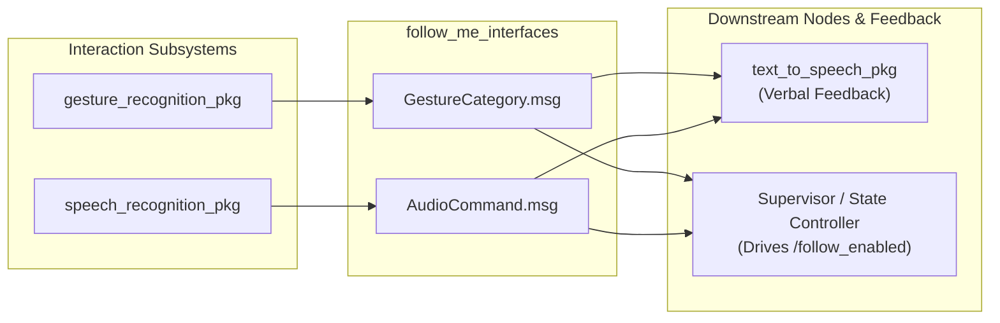

<!--
Copyright (C) 2026 Intel Corporation

SPDX-License-Identifier: Apache-2.0
-->

# Follow-Me Interfaces (`follow_me_interfaces`)

The `follow_me_interfaces` package defines custom ROS 2 message types used for multi-modal human-robot interaction across the Follow-Me application packages.

---

## Message Definitions

### 1. `AudioCommand.msg`

Defines a verbal voice command classified by the speech recognition subsystem:

```
# follow_me_interfaces/msg/AudioCommand.msg
string audio_command
```

**Common Values**:

- `"start"`: Voice command requesting the robot to begin following.
- `"stop"`: Voice command instructing the robot to halt motion.

### 2. `GestureCategory.msg`

Defines a hand gesture category recognized by the visual gesture recognition subsystem:

```
# follow_me_interfaces/msg/GestureCategory.msg
string gesture_category
```

**Common Values**:

- `"Open_Palm"`: Stop/halt gesture.
- `"Pointing_Up"`: Start/follow gesture.
- `"Thumb_Up"`: Acknowledgment or confirmation.

---

## Architecture & System Role



These message definitions decouple model inference nodes (`gesture_recognition_pkg`, `speech_recognition_pkg`) from consumers and supervisor nodes, providing a clean API contract for multi-modal perception.

---

## Usage in Downstream Packages

### C++

In your `CMakeLists.txt`:

```cmake
find_package(follow_me_interfaces REQUIRED)
ament_target_dependencies(your_node follow_me_interfaces)
```

In your `package.xml`:

```xml
<depend>follow_me_interfaces</depend>
```

In your C++ source code:

```cpp
#include <follow_me_interfaces/msg/audio_command.hpp>
#include <follow_me_interfaces/msg/gesture_category.hpp>

// ...
auto audio_msg = follow_me_interfaces::msg::AudioCommand();
audio_msg.audio_command = "start";
```

### Python

In your `package.xml`:

```xml
<depend>follow_me_interfaces</depend>
```

In your Python code:

```python
from follow_me_interfaces.msg import AudioCommand, GestureCategory

msg = AudioCommand()
msg.audio_command = 'stop'
```

---

## Building the Package

```bash
source /opt/ros/${ROS_DISTRO}/setup.bash
colcon build --packages-select follow_me_interfaces
source install/setup.bash
```
