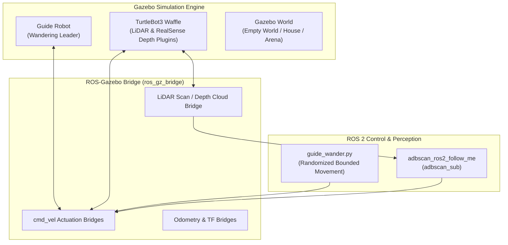

<!--
Copyright (C) 2026 Intel Corporation

SPDX-License-Identifier: Apache-2.0
-->

# Follow-Me TurtleBot3 Gazebo Simulation (`followme_turtlebot3_gazebo`)

This package provides Gazebo simulation environments, robot models, and launch configurations for testing the ADBSCAN Follow-Me AMR application with TurtleBot3 and guide robots in simulated environments.

---

## Architecture & Simulation Setup



### Key Components

1. **Guide Robot (`guide_robot`)**:
   - Airport-style leader vehicle featuring a distinctive high-contrast black-and-yellow checkerboard texture.
   - Controlled by the `guide_wander.py` script to wander autonomously within bounded limits, or driven manually via `/guide_robot/cmd_vel`.
2. **Follower Robot (`turtlebot3_waffle_depth`)**:
   - Simulated TurtleBot3 Waffle AMR equipped with simulated 2D planar LiDAR and Intel® RealSense™ depth camera sensor plugins.
3. **Simulation Bridges**:
   - Bi-directional ROS 2 / Gazebo communication bridges translating sensor data, odometry, TF frames, and velocity commands.
4. **Simulator Compatibility**:
   - **ROS 2 Jazzy**: Powered by **Gazebo Harmonic** (`ros_gz_sim`).
   - **ROS 2 Humble**: Powered by **Gazebo Fortress** (`ros_gz_sim`).

---

## Directory Layout

- `launch/`: Simulation launch orchestrators.
  - `follow_me.launch.py`: Top-level launch script spawning both robots, bridges, guide wander script, and the follower node.
  - `spawn_gbot.launch.py`, `spawn_turtlebot3.launch.py`: Spawning helpers.
  - `lidar_shared.launch.py`, `rs_shared.launch.py`: Sensor bridge configurations.
- `models/`: Simulation SDF, URDF, and texture assets:
  - `models/guide_robot`: Leader robot geometry and checkerboard material.
  - `models/turtlebot3_waffle_depth`: Follower robot SDF and sensor mounts.
- `scripts/`:
  - `guide_wander.py`: Autonomous guide motion generator with bounded odometry constraints.
- `rviz/`: Preconfigured RViz visualization setups.

---

## Launching the Simulation

### Prerequisites

Ensure ROS 2 and the matching Gazebo dependencies are installed:

```bash
source /opt/ros/${ROS_DISTRO}/setup.bash
colcon build --packages-select followme_turtlebot3_gazebo adbscan_ros2_follow_me adbscan_core
source install/setup.bash
```

### Full Simulation with 2D LiDAR (Default)

```bash
ros2 launch followme_turtlebot3_gazebo follow_me.launch.py
```

This command launches:

1. Gazebo with an empty ground-plane world.
2. The guide robot spawned ahead of the follower.
3. The follower robot running `adbscan_ros2_follow_me`.
4. The autonomous wander script driving the guide robot.

### Simulation with Intel RealSense Depth Camera

To use the simulated RealSense depth point cloud instead of 2D LiDAR:

```bash
ros2 launch followme_turtlebot3_gazebo follow_me.launch.py sensor:=realsense
```

### Manual Guide Control

To steer the guide robot manually instead of letting it wander autonomously:

```bash
# Terminal 1: Launch with manual guide motion
ros2 launch followme_turtlebot3_gazebo follow_me.launch.py guide_motion:=manual

# Terminal 2: Publish steering commands
ros2 topic pub -r 10 /guide_robot/cmd_vel geometry_msgs/msg/Twist '{linear: {x: 0.15}, angular: {z: 0.2}}'
```

---

## Launch Arguments

The `follow_me.launch.py` script supports the following launch arguments:

| Argument | Type | Default | Description |
| --- | --- | --- | --- |
| `sensor` | string | `lidar` | Sensor modality: `lidar` (2D LiDAR scan) or `realsense` (3D depth cloud). |
| `guide_motion` | string | `wander` | Guide robot control mode: `wander` (randomized bounded motion) or `manual` (external `/guide_robot/cmd_vel`). |
| `start_enabled` | bool | `true` | Start following motion immediately upon launch (`false` waits for `/follow_enabled`). |
| `backend` | string | `legacy_cpu` | ADBSCAN search backend: `legacy_cpu`, `pcl_kdtree`, `oneapi_kdtree`, or `oneapi_octree`. |
| `device` | string | `cpu` | Device target when using oneAPI backends: `cpu` or `gpu`. |
| `headless` | bool | `false` | Run Gazebo headlessly without opening the GUI client. |
| `use_sim_time` | bool | `true` | Use simulation clock (`/clock`) for all ROS nodes. |
