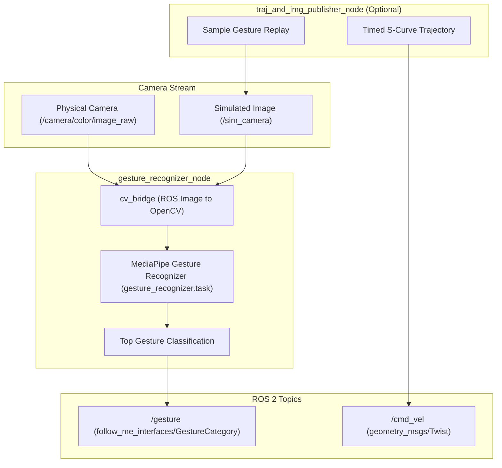

<!--
Copyright (C) 2026 Intel Corporation

SPDX-License-Identifier: Apache-2.0
-->

# Gesture Recognition Package (`gesture_recognition_pkg`)

> **Note**: This is an experimental multi-modal interaction package preserved for reference. It is not required for core ADBSCAN clustering or basic follow-me motion.

The `gesture_recognition_pkg` provides real-time vision-based hand gesture recognition from an RGB camera stream using Google MediaPipe. Recognized gestures are published as typed ROS 2 messages (`follow_me_interfaces/msg/GestureCategory`) to trigger robot behaviors (such as starting or halting target following).

---

## Architecture



---

## Nodes

### 1. `gesture_recognizer_node`

The main perception node running real-time gesture inference.

- **Subscribed Topics**:
  - `/camera/color/image_raw` (`sensor_msgs/msg/Image`): Live camera RGB stream (when `use_sim_time: false`).
  - `/sim_camera` (`sensor_msgs/msg/Image`): Simulated camera stream (when `use_sim_time: true`).
- **Published Topics**:
  - `gesture` (`follow_me_interfaces/msg/GestureCategory`): Recognized gesture category string (e.g., `"Pointing_Up"`, `"Open_Palm"`, `"Thumb_Up"`).
- **Parameters**:
  - `Camera_topic` (string, default: `/camera/color/image_raw`): Input topic for real camera images.
  - `simulated_camera_topic` (string, default: `/sim_camera`): Input topic for simulated camera images.
  - `use_sim_time` (bool, default: `false`): Enables simulation mode.

### 2. `traj_and_img_publisher_node`

A simulation testing node that simultaneously publishes guide robot velocity commands (`cmd_vel`) and replays static gesture images from `config/gesture_imgs/` onto `/sim_camera`.

- **Published Topics**:
  - `/sim_camera` (`sensor_msgs/msg/Image`): Simulated camera frames.
  - `/cmd_vel` (`geometry_msgs/msg/Twist`): Timed S-curve guide velocity trajectory.
- **Parameters**:
  - `odom_topic` (string, default: `/odom`)
  - `twist_topic` (string, default: `/cmd_vel`)
  - `publish_frequency` (int, default: `10`)
  - `Camera_topic` (string, default: `/sim_camera`)

---

## Configuration & Model Assets

- `config/gesture_recognizer.task`: Pre-trained MediaPipe gesture classification task model bundle.
- `config/gesture_recognition.yaml`: Default parameters for live camera perception.
- `config/gesture_recognition_robot_bringup.yaml`: Bringup parameters for AMR integration.
- `config/gesture_imgs/`: Reference gesture images (`point.jpg`, `palm.jpg`, etc.) used for simulation verification.

---

## Building and Running

### Prerequisites

In addition to ROS 2 build tools, this package requires Python dependencies:

- `mediapipe`
- `opencv-python`
- `cv_bridge`

### Build the Package

```bash
source /opt/ros/${ROS_DISTRO}/setup.bash
colcon build --packages-select follow_me_interfaces gesture_recognition_pkg
source install/setup.bash
```

### Run the Gesture Recognizer Node

```bash
ros2 run gesture_recognition_pkg gesture_recognition_node --ros-args \
  --params-file "$(ros2 pkg prefix gesture_recognition_pkg)/share/gesture_recognition_pkg/config/gesture_recognition.yaml"
```

Monitor recognized gestures:

```bash
ros2 topic echo /gesture
```
