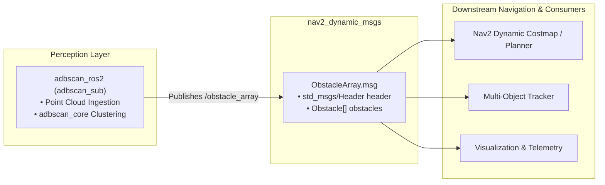

<!--
Copyright (C) 2026 Intel Corporation

SPDX-License-Identifier: Apache-2.0
-->

# Dynamic Obstacle Messages (`nav2_dynamic_msgs`)

The `nav2_dynamic_msgs` package defines standard ROS 2 message definitions for representing 3D spatial obstacles and arrays of detected dynamic objects.

In this repository, it serves as the perception-to-navigation interface contract: the `adbscan_ros2` perception node clusters raw sensor point clouds and publishes the segmented objects as `nav2_dynamic_msgs::msg::ObstacleArray`. Downstream consumers—such as Navigation 2 (Nav2) dynamic costmaps, obstacle trackers, or collision avoidance planners—ingest these messages to perform navigation and path planning.

---

## Architecture & Data Flow



---

## Message Definitions

### 1. `Obstacle.msg`

Defines a single detected or tracked 3D spatial obstacle:

```protobuf
unique_identifier_msgs/UUID uuid
float32 score
geometry_msgs/Point position
geometry_msgs/Vector3 velocity
geometry_msgs/Vector3 size
```

| Field | Type | Description |
| --- | --- | --- |
| `uuid` | `unique_identifier_msgs/UUID` | Unique 128-bit identifier assigned to this obstacle for inter-frame tracking and data association. |
| `score` | `float32` | Confidence score or density quality metric for the detected cluster (e.g., $1.0$ for valid clusters). |
| `position` | `geometry_msgs/Point` | 3D position coordinates $(x, y, z)$ in meters, representing the cluster centroid in the reference frame. |
| `velocity` | `geometry_msgs/Vector3` | Estimated linear velocity vector $(v_x, v_y, v_z)$ in meters per second (zeros if untracked). |
| `size` | `geometry_msgs/Vector3` | Axis-aligned 3D bounding box dimensions $(\text{size}_x, \text{size}_y, \text{size}_z)$ in meters. |

### 2. `ObstacleArray.msg`

Contains an array of obstacles detected within a single sensor scan or point cloud frame:

```protobuf
std_msgs/Header header
Obstacle[] obstacles
```

| Field | Type | Description |
| --- | --- | --- |
| `header` | `std_msgs/Header` | Includes timestamp and coordinate `frame_id` (e.g., `base_link`, `velodyne`, `camera_link`). |
| `obstacles` | `Obstacle[]` | Dynamic array of all active `Obstacle` items detected in the frame. |

---

## Usage in Downstream Packages

### C++ Usage

In your package's `package.xml`:

```xml
<depend>nav2_dynamic_msgs</depend>
```

In your `CMakeLists.txt`:

```cmake
find_package(nav2_dynamic_msgs REQUIRED)
ament_target_dependencies(your_node_target nav2_dynamic_msgs)
```

In your C++ source code:

```cpp
#include <nav2_dynamic_msgs/msg/obstacle_array.hpp>
#include <nav2_dynamic_msgs/msg/obstacle.hpp>

// Subscribing to obstacles:
auto sub = node->create_subscription<nav2_dynamic_msgs::msg::ObstacleArray>(
  "obstacle_array", 10,
  [](const nav2_dynamic_msgs::msg::ObstacleArray::SharedPtr msg) {
    for (const auto & obs : msg->obstacles) {
      RCLCPP_INFO(
        rclcpp::get_logger("obs_listener"),
        "Obstacle at (%.2f, %.2f, %.2f) with size (%.2f, %.2f, %.2f)",
        obs.position.x, obs.position.y, obs.position.z,
        obs.size.x, obs.size.y, obs.size.z);
    }
  });
```

### Python Usage

In your package's `package.xml`:

```xml
<depend>nav2_dynamic_msgs</depend>
```

In your Python source code:

```python
from nav2_dynamic_msgs.msg import Obstacle, ObstacleArray

def obstacle_callback(msg: ObstacleArray):
    for obs in msg.obstacles:
        print(f"Obstacle at ({obs.position.x:.2f}, {obs.position.y:.2f})")
```

---

## Building and Packaging

### Build from Source

Build the interfaces in your ROS 2 colcon workspace:

```bash
source /opt/ros/${ROS_DISTRO}/setup.bash
colcon build --packages-select nav2_dynamic_msgs
source install/setup.bash
```

### Packaging into Debian Packages

To produce Debian packages for deployment on Ubuntu:

```bash
# Package for ROS 2 Jazzy or Humble
make package ROS_DISTRO=jazzy
```

The resulting package will be output to `build/debian-packages/packages/ros-${ROS_DISTRO}-nav2-dynamic-msgs_*.deb`.
