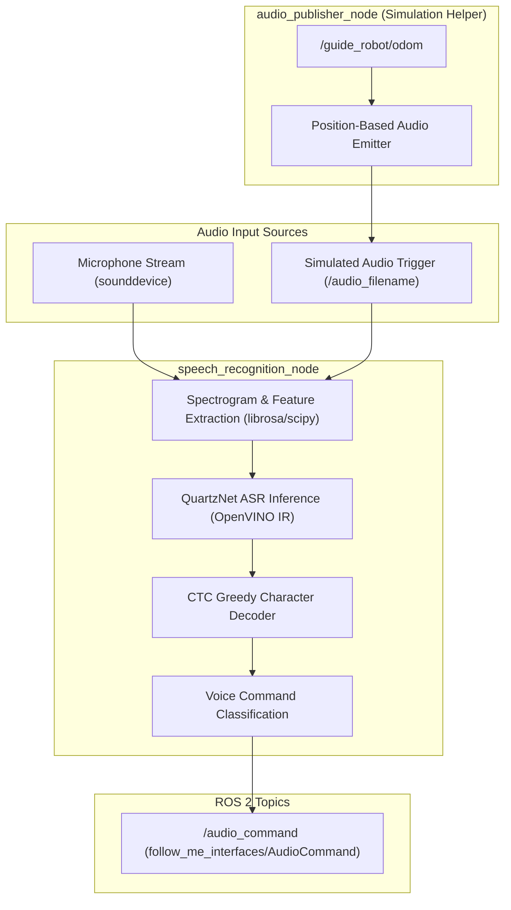

<!--
Copyright (C) 2026 Intel Corporation

SPDX-License-Identifier: Apache-2.0
-->

# Speech Recognition Package (`speech_recognition_pkg`)

> **Note**: This is an experimental multi-modal interaction package preserved for reference. It is not required for core ADBSCAN clustering or basic follow-me motion.

The `speech_recognition_pkg` provides voice command recognition using an Intel® OpenVINO™-optimized QuartzNet acoustic model. It captures spoken audio commands, transcribes and classifies them, and publishes structured messages (`follow_me_interfaces/msg/AudioCommand`) to control AMR follow-me behaviors.

---

## Architecture



---

## Nodes

### 1. `speech_recognition_node`

The core voice recognition node.

- **Subscribed Topics**:
  - `audio_filename` (`std_msgs/msg/String`, optional): Path to a WAV file to transcribe in simulation mode.
- **Published Topics**:
  - `audio_command` (`follow_me_interfaces/msg/AudioCommand`): Top recognized verbal command (e.g., `"start"`, `"stop"`).
- **Parameters**:
  - `device_name` (string, default: `CPU`): OpenVINO execution target (e.g., `CPU`, `GPU`).
  - `threshold` (float, default: `0.7`): Confidence threshold for command acceptance.
  - `model_path`: Location of the QuartzNet OpenVINO IR files.

### 2. `audio_publisher_node`

A simulation helper node that monitors guide robot odometry and emits appropriate simulated audio file paths to trigger follower behaviors at set waypoints.

- **Subscribed Topics**:
  - `/guide_robot/odom` (`nav_msgs/msg/Odometry`): Guide robot position.
- **Published Topics**:
  - `audio_filename` (`std_msgs/msg/String`): Target WAV file path to simulate spoken words.
- **Parameters**:
  - `odom_topic` (string, default: `/guide_robot/odom`)
  - `publish_frequency` (int, default: `10`)

---

## Models & Assets

Located in `config/`:

- `model_files/`: OpenVINO intermediate representation (IR) XML and bin files for QuartzNet speech recognition.
- `audio_files/`: Reference WAV recordings of commands (e.g., "start", "stop") used for automated testing.
- `speech_recognition.yaml`: Parameter configuration.

---

## Building and Running

### Prerequisites

Requires Python audio and deep learning dependencies:

- `openvino`
- `librosa`
- `sounddevice`
- `scipy`
- `numpy`

### Build the Package

```bash
source /opt/ros/${ROS_DISTRO}/setup.bash
colcon build --packages-select follow_me_interfaces speech_recognition_pkg
source install/setup.bash
```

### Run the Speech Recognition Node

```bash
ros2 run speech_recognition_pkg speech_recognition_node --ros-args \
  --params-file "$(ros2 pkg prefix speech_recognition_pkg)/share/speech_recognition_pkg/config/speech_recognition.yaml"
```

Monitor recognized commands:

```bash
ros2 topic echo /audio_command
```
