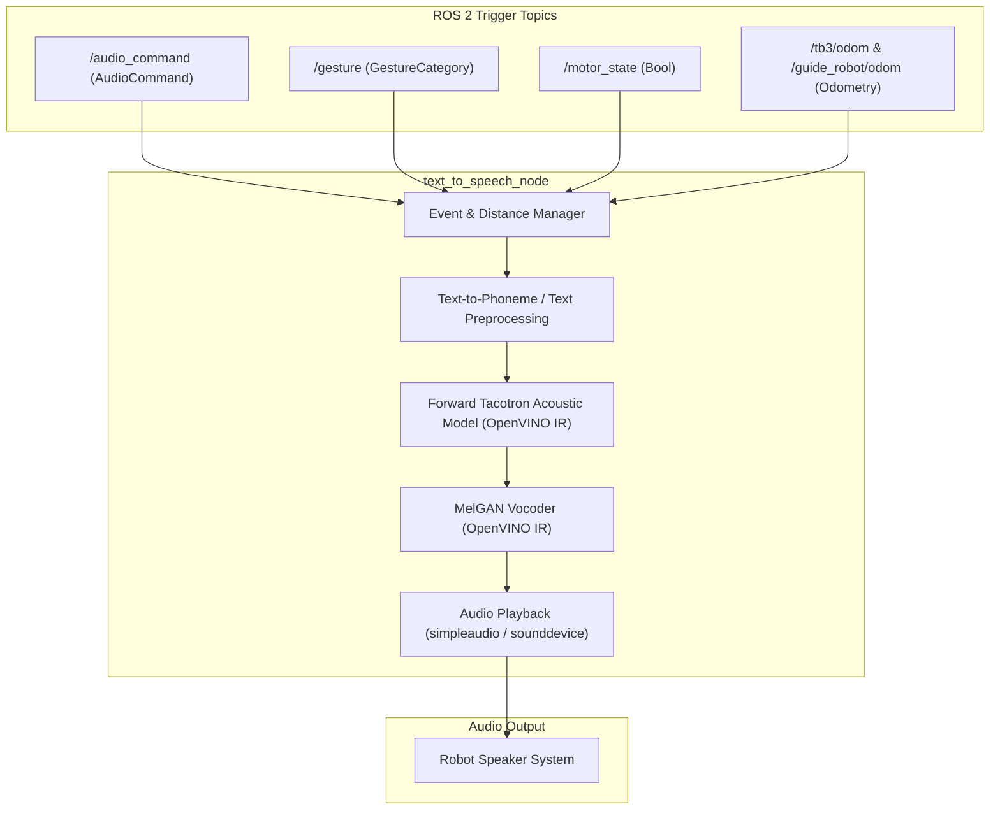

<!--
Copyright (C) 2026 Intel Corporation

SPDX-License-Identifier: Apache-2.0
-->

# Text-to-Speech Package (`text_to_speech_pkg`)

> **Note**: This is an experimental multi-modal interaction package preserved for reference. It is not required for core ADBSCAN clustering or basic follow-me motion.

The `text_to_speech_pkg` provides neural voice synthesis for mobile robots using Intel® OpenVINO™ with Forward Tacotron and MelGAN models. It gives verbal status feedback acknowledging commands, announcing robot motor engagement, and warning of proximity changes during target following.

---

## Architecture



---

## Node Details: `text_to_speech_node`

### Subscribed Topics

| Topic | Message Type | Description |
| --- | --- | --- |
| `audio_command` | `follow_me_interfaces/msg/AudioCommand` | Incoming voice commands to be acknowledged verbally. |
| `gesture` | `follow_me_interfaces/msg/GestureCategory` | Incoming hand gestures to be acknowledged verbally. |
| `motor_state` | `std_msgs/msg/Bool` | Robot drive motor status (announces engagement / disengagement). |
| `/tb3/odom` | `nav_msgs/msg/Odometry` | Follower AMR odometry for proximity calculation. |
| `/guide_robot/odom` | `nav_msgs/msg/Odometry` | Guide robot odometry for proximity calculation. |
| `target_loc` | `geometry_msgs/msg/Point` | Optional 3D target coordinates. |

### Parameters

- `device_name` (string, default: `CPU`): OpenVINO inference device (`CPU` or `GPU`).
- `tbot_odom_topic_name` (string, default: `/tb3/odom`): Follower odometry topic.
- `gbot_odom_topic_name` (string, default: `/guide_robot/odom`): Guide odometry topic.
- `audio_play_frequency` (float, default: `2.0`): Rate limit for consecutive voice announcements.
- `distance_calculation_frequency` (float, default: `2.0`): Frequency to compute guide-follower separation.

---

## Models & Assets

Located in `config/`:

- `model_files/`: OpenVINO Intermediate Representation (IR) files for:
  - Duration prediction: `text-to-speech-en-0001-duration-prediction.{xml,bin}`
  - Mel generation: `text-to-speech-en-0001-generation.{xml,bin}`
  - Mel regression: `text-to-speech-en-0001-regression.{xml,bin}`
- `text_to_speech_config.yaml`: Configuration settings for TTS execution.

---

## Building and Running

### Prerequisites

Requires Python dependencies:

- `openvino`
- `simpleaudio`
- `scipy`
- `numpy`
- `tqdm`

### Build the Package

```bash
source /opt/ros/${ROS_DISTRO}/setup.bash
colcon build --packages-select follow_me_interfaces text_to_speech_pkg
source install/setup.bash
```

### Run the Node

```bash
ros2 run text_to_speech_pkg text_to_speech_node --ros-args \
  --params-file "$(ros2 pkg prefix text_to_speech_pkg)/share/text_to_speech_pkg/config/text_to_speech_config.yaml"
```
