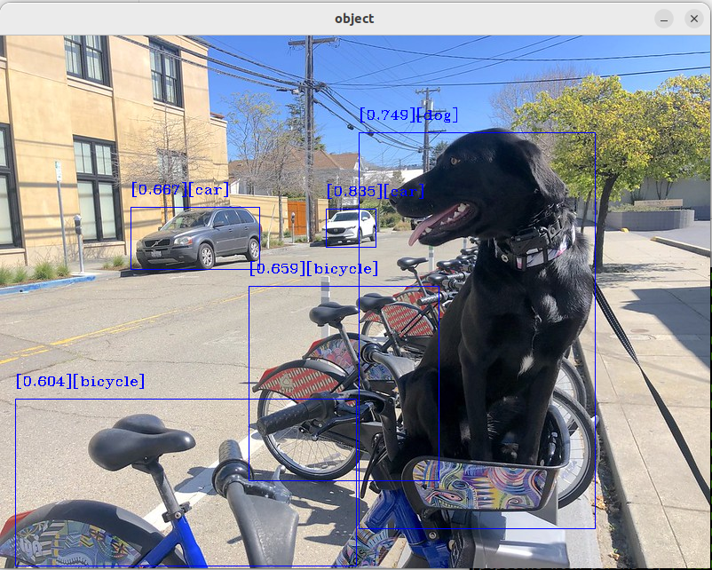

<!--
Copyright (C) 2025 Intel Corporation

SPDX-License-Identifier: Apache-2.0
-->

# OpenVINO™ Object Detection Tutorial

---

This tutorial demonstrates the ROS 2 OpenVINO™ node for object detection.
It explains how to install the node and run an object detection model. Set
the `device` launch argument to choose the inference device: NPU, GPU, or
CPU.

## Source Code

The source code of this component can be found here:
[Object-Detection](https://github.com/open-edge-platform/edge-ai-suites/tree/main/robotics-ai-suite/components/object-detection)

## Prerequisites

- [Prepare the target system](https://developer.robotics.intel.com/development-stack/platform_foundation/getting_started/)
- [Setup the Robotics AI Dev Kit APT Repositories](https://developer.robotics.intel.com/development-stack/platform_foundation/getting_started/step_by_step/#3-set-up-robotics-ai-suite-oneapi-and-graphics-apt-repositories)
- [Install OpenVINO™ Packages](https://developer.robotics.intel.com/development-stack/platform_foundation/getting_started/step_by_step/#4-install-openvino-packages)
- [Install Robotics AI Dev Kit Deb packages](https://developer.robotics.intel.com/development-stack/platform_foundation/getting_started/step_by_step/#6-install-robotics-ai-suite-deb-packages)
- [Install the Intel® NPU Driver on Intel® Core™ Ultra Processors (if applicable)](https://developer.robotics.intel.com/development-stack/platform_foundation/getting_started/step_by_step/#7-install-the-intel-npu-driver-on-intel-core-ultra-processors)

## Install the tutorial package

```bash
sudo apt install ros-humble-object-detection-tutorial
```

For ROS 2 Jazzy, replace `humble` in the package name with `jazzy`.

## Run the Demo with an Image Input

Run the following command to launch the object detection node. By
default it runs on the GPU, and on the CPU when no GPU is available:

```bash
ros2 launch object_detection_tutorial openvino_object_detection.launch.py
```

To select the inference engine, add the `device` argument:

- GPU inference engine

  ```bash
  ros2 launch object_detection_tutorial openvino_object_detection.launch.py device:=GPU
  ```

- CPU inference engine

  ```bash
  ros2 launch object_detection_tutorial openvino_object_detection.launch.py device:=CPU
  ```

- NPU inference engine

  ```bash
  ros2 launch object_detection_tutorial openvino_object_detection.launch.py device:=NPU
  ```

> [!NOTE]
> The default, `device:=AUTO`, uses OpenVINO's automatic device
> selection (`AUTO:GPU,CPU`). It does not include the NPU; select it
> with `device:=NPU`. If the selected device is not available, the
> tutorial stops and lists the devices OpenVINO can use.

When launched, the node downloads the `mobilenetssd` model, converts it
to OpenVINO IR format, and begins inference.

## Run without a display

On a system without a display, for example over SSH, the launch file
runs in headless mode: RViz is not started, and the detections are
printed to the terminal about once per second:

```text
[print_detections.py-2] 215 msg/s | car 0.84, parking 0.75, car 0.67, bicycle 0.66, bicycle 0.60
```

The `headless` launch argument controls this:

- `headless:=auto` (default): headless when neither `DISPLAY` nor
  `WAYLAND_DISPLAY` is set, or the X display cannot be opened
- `headless:=true`: always headless, even with a display
- `headless:=false`: always start RViz; stops with an error when no
  display is available

For example, to run on the CPU without RViz:

```bash
ros2 launch object_detection_tutorial openvino_object_detection.launch.py device:=CPU headless:=true
```

The full results are also published on
`/ros2_openvino_toolkit/detected_objects`
(`object_msgs/msg/ObjectsInBoxes`).

## Expected Output



To stop the application, press `Ctrl+C` in the terminal running the
launch command.
