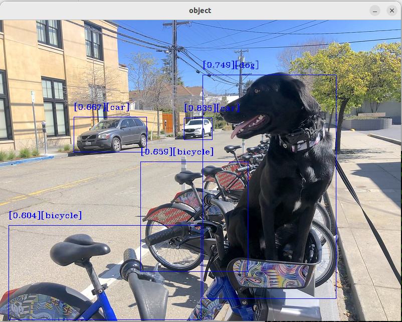

<!--
Copyright (C) 2025 Intel Corporation

SPDX-License-Identifier: Apache-2.0
-->

# OpenVINO™ Object Detection Tutorial

---

This tutorial demonstrates the ROS 2 OpenVINO™ node for object detection.
It explains how to install the node and run an object detection model. Set
the `device` launch argument to choose the inference device: NPU, GPU, or
CPU.

## Source Code

The source code of this component can be found here:
[Object-Detection](https://github.com/open-edge-platform/edge-ai-suites/tree/main/robotics-ai-suite/components/object-detection)

## Prerequisites

- [Prepare the target system](https://developer.robotics.intel.com/development-stack/platform_foundation/getting_started/)
- [Setup the Robotics AI Dev Kit APT Repositories](https://developer.robotics.intel.com/development-stack/platform_foundation/getting_started/step_by_step/#3-set-up-robotics-ai-suite-oneapi-and-graphics-apt-repositories)
- [Install OpenVINO™ Packages](https://developer.robotics.intel.com/development-stack/platform_foundation/getting_started/step_by_step/#4-install-openvino-packages)
- [Install Robotics AI Dev Kit Deb packages](https://developer.robotics.intel.com/development-stack/platform_foundation/getting_started/step_by_step/#6-install-robotics-ai-suite-deb-packages)
- [Install the Intel® NPU Driver on Intel® Core™ Ultra Processors (if applicable)](https://developer.robotics.intel.com/development-stack/platform_foundation/getting_started/step_by_step/#7-install-the-intel-npu-driver-on-intel-core-ultra-processors)

## Install the tutorial package

```bash
sudo apt install ros-humble-object-detection-tutorial
```

For ROS 2 Jazzy, replace `humble` in the package name with `jazzy`.

## Run the Demo with an Image Input

Run one of the following commands to launch the object detection node
with a specific inference engine:

- GPU inference engine

  ```bash
  ros2 launch object_detection_tutorial openvino_object_detection.launch.py device:=GPU
  ```

- CPU inference engine

  ```bash
  ros2 launch object_detection_tutorial openvino_object_detection.launch.py device:=CPU
  ```

- NPU inference engine

  ```bash
  ros2 launch object_detection_tutorial openvino_object_detection.launch.py device:=NPU
  ```

> [!NOTE]
> If no device is specified, the GPU is selected by default as an
> inference engine.

When launched, the node downloads the `mobilenetssd` model, converts it
to OpenVINO IR format, and begins inference.

## Expected Output



To stop the application, press `Ctrl+C` in the terminal running the
launch command.
