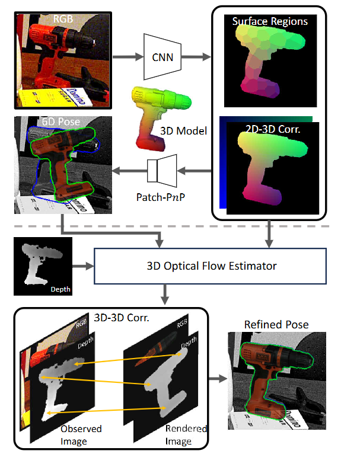

# GDRNPP 6D Pose Estimation with OpenVINO

6D object pose estimation determines where an object is and how it is oriented
in 3D space. The six degrees of freedom comprise three translation axes and
three rotation axes, providing the spatial information that robots need for
tasks such as object localization, grasping, and manipulation.

GDRNPP combines YOLOX object detection with GDRN pose estimation to recover
the 3D rotation and translation of known objects from RGB images. This
implementation uses the OpenVINO toolkit to accelerate the end-to-end pipeline
on Intel CPUs and GPUs, with support for direct regression, PnP RANSAC, and
optional depth-based pose refinement.

```text
Image ──► YOLOX (detection) ──► GDRN (pose estimation)
                                       │
                    outputs: 6D Poses(rot6d + trans) + coor_xyz + mask
                                       │
                              ┌────────┴────────┐
                              ▼                 ▼
                      Direct Regression      coor_xyz + mask
                      (rot6d + trans)           │
                              │                 ▼
                              │            PnP RANSAC → rot6d + trans
                              └─────┐
                                    ▼
                              Optional: Depth Refine ──► Refined 6D Poses
```

<p align="center">
  
</p>

The OpenVINO models produce 6D poses together with dense object coordinates
and a visibility mask. The pipeline supports direct pose regression, optional
PnP RANSAC, and optional depth-based translation refinement.

## Features

- OpenVINO inference for both YOLOX and GDRN.
- Intel CPU, GPU, and `AUTO` device selection.
- Inference from YOLOX detections or pre-computed bounding boxes.
- Direct-regression and PnP RANSAC pose estimation modes.
- Optional depth-based translation refinement.
- Fixed GDRN batch buckets to avoid repeated GPU kernel compilation.
- BOP-format prediction output, evaluation, and per-stage profiling.
- Lightweight deployment environment without PyTorch, torchvision, mmcv, or
  detectron2.

## Pipeline Preparation

### 1. Initialize the Upstream Submodule

Run the following commands from the directory containing this README:

```bash
git submodule update --init gdrnpp
cd gdrnpp
```

The submodule is pinned to commit
`b80383bd7b0ea9f165bb019ecf846f261e60e56f`, the `main` branch baseline used
to generate the OpenVINO patch.

### 2. Apply the OpenVINO Patch

Apply the OpenVINO integration patch from this pipeline directory:

```bash
git am ../patches/0001-Feat-Add-GDRNPP-OpenVINO-pipeline.patch
```

The patch adds the OpenVINO export scripts, inference pipeline, BOP evaluation
driver, deployment requirements, profiling, depth refinement, and Intel GPU
container setup described in this document.

## Environment Setup

The development environment uses Docker and includes OpenVINO,
PyTorch, Intel GPU drivers, Mesa, and the model-conversion dependencies.

```bash
# Build the image and start the development container.
bash docker_build_run.sh

# Enter the running container.
docker exec -it gdrnpp_dev bash
```

To build or start the container separately:

```bash
bash docker_build_run.sh --build-only
bash docker_build_run.sh --run-only
```

Intel GPU access is passed into the container through `/dev/dri`. The setup
also builds the `CppEGLRenderer` extension used by depth refinement. If EGL is
unavailable, the implementation falls back to the slower CPU renderer and
reports the initialization error.

### Lightweight Deployment

Model conversion requires the full development environment. Deployment with
exported OpenVINO IR models uses a smaller Python environment:

```bash
python3 -m venv .venv-deploy
source .venv-deploy/bin/activate
pip install -r requirements/requirements_deploy.txt
```

For depth refinement on Ubuntu 24.04, install the EGL build dependencies and
compile the renderer:

```bash
sudo apt-get update
sudo apt-get install -y build-essential cmake python3-dev \
    libgl1-mesa-dev libegl1-mesa-dev
bash lib/egl_renderer/compile_cpp_egl_renderer.sh
```

The lightweight environment supports inference, YOLOX post-processing, and EGL
depth refinement. BOP scoring has additional dependencies; use `--save-only`
or run scoring in the full development container.

## Model Conversion

Run all commands from the GDRNPP repository root.

### Export YOLOX

```bash
python tools/openvino/export_yolox_openvino.py \
    --ckpt <path-to-yolox-checkpoint> \
    --output models/openvino/yolox \
    --convert-mode pytorch-ov \
    --fp16 \
    --verify
```

### Export GDRN

```bash
python tools/openvino/export_gdrn_openvino.py \
    --ckpt <path-to-gdrn-checkpoint> \
    --output models/openvino/gdrn \
    --convert-mode pytorch-ov \
    --fp16 \
    --verify
```

The GDRN OpenVINO model has six outputs:

- `pred_rot`
- `pred_t`
- `coor_x`
- `coor_y`
- `coor_z`
- `vis_mask`

The generated model layout is:

```text
models/openvino/
├── yolox/
│   ├── yolox.xml
│   └── yolox.bin
└── gdrn/
    ├── gdrn.xml
    └── gdrn.bin
```

## LM-O BOP Demo

The LM-O demo is the shortest reproducible evaluation path. It uses published
detections by default, so exporting YOLOX is optional.

### 1. Download the GDRN Checkpoint and Published Detections

```bash
GDRN_DIR=output/gdrn/lmo_pbr/convnext_a6_AugCosyAAEGray_BG05_mlL1_DMask_amodalClipBox_classAware_lmo
DET_DIR=datasets/BOP_DATASETS/lmo/test/test_bboxes

mkdir -p "$GDRN_DIR" "$DET_DIR"

curl -fL --retry 3 \
    https://www.modelscope.cn/models/wangg12/GDRNPP/resolve/master/gdrn/lmo_pbr/convnext_a6_AugCosyAAEGray_BG05_mlL1_DMask_amodalClipBox_classAware_lmo/model_final_wo_optim.pth \
    -o "$GDRN_DIR/model_final_wo_optim.pth"

curl -fL --retry 3 \
    https://www.modelscope.cn/datasets/wangg12/GDRNPP_bop22_test_bboxes/resolve/master/datasets/BOP_DATASETS/lmo/test/test_bboxes/yolox_x_640_lmo_pbr_lmo_bop_test.json \
    -o "$DET_DIR/yolox_x_640_lmo_pbr_lmo_bop_test.json"
```

### 2. Download the LM-O Test Data

Download `lmo_base.zip`, `lmo_models.zip`, and `lmo_test_bop19.zip` from the
[BOP dataset repository](https://bop.felk.cvut.cz/datasets/), then extract them
so that the dataset contains:

```text
datasets/BOP_DATASETS/lmo/
├── models/models_info.json
├── test/000002/rgb/
├── test/000002/scene_camera.json
├── test/test_bboxes/yolox_x_640_lmo_pbr_lmo_bop_test.json
└── test_targets_bop19.json
```

### 3. Export the LM-O GDRN Model

```bash
python tools/openvino/export_gdrn_openvino.py \
    --ckpt "$GDRN_DIR/model_final_wo_optim.pth" \
    --output models/openvino/gdrn_lmo \
    --convert-mode pytorch-ov \
    --fp16 \
    --verify
```

### 4. Verify the OpenVINO Device

```bash
python -c "from openvino import Core; print(Core().available_devices)"
```

Use `--device CPU` for evaluation if the output does not contain `GPU`.

### 5. Run Inference with Published Detections

```bash
BOP_PATH=datasets/BOP_DATASETS \
python tools/openvino/eval_bop_openvino.py \
    --gdrn-model models/openvino/gdrn_lmo/gdrn.xml \
    --det-file datasets/BOP_DATASETS/lmo/test/test_bboxes/yolox_x_640_lmo_pbr_lmo_bop_test.json \
    --dataset-dir datasets/BOP_DATASETS/lmo \
    --device GPU \
    --output eval_output/lmo_openvino \
    --profile \
    --save-only
```

The command writes:

- `gdrnpp-openvino-predet_lmo-test.csv`: BOP-format predictions.
- `timing_per_image.csv`: per-image timing data.
- `eval_args.json`: command-line arguments used for the run.
- `profiling_report.txt`: hierarchical stage timing when `--profile` is set.

Remove `--save-only` to run the bundled BOP scorer after inference:

```bash
BOP_PATH=datasets/BOP_DATASETS \
python tools/openvino/eval_bop_openvino.py \
    --gdrn-model models/openvino/gdrn_lmo/gdrn.xml \
    --det-file datasets/BOP_DATASETS/lmo/test/test_bboxes/yolox_x_640_lmo_pbr_lmo_bop_test.json \
    --dataset-dir datasets/BOP_DATASETS/lmo \
    --device GPU \
    --output eval_output/lmo_openvino
```

### Complete YOLOX and GDRN Pipeline

After exporting both models, replace `--det-file` with `--yolox-model`:

```bash
BOP_PATH=datasets/BOP_DATASETS \
python tools/openvino/eval_bop_openvino.py \
    --yolox-model models/openvino/yolox/yolox.xml \
    --gdrn-model models/openvino/gdrn_lmo/gdrn.xml \
    --dataset-dir datasets/BOP_DATASETS/lmo \
    --device GPU \
    --output eval_output/lmo_openvino_e2e \
    --save-only
```

## Evaluation Options

| Argument | Default | Description |
| --- | --- | --- |
| `--gdrn-model` | Required | Path to the GDRN OpenVINO `.xml` model |
| `--yolox-model` | `None` | Path to the YOLOX `.xml` model |
| `--det-file` | `None` | Pre-computed detection JSON; skips YOLOX |
| `--det-score-thr` | `0.0` | Score threshold for pre-computed detections |
| `--dataset-dir` | `datasets/BOP_DATASETS/lmo` | BOP dataset root |
| `--output` | `eval_output/lmo_openvino` | Prediction and report directory |
| `--device` | `GPU` | OpenVINO device: `CPU`, `GPU`, or `AUTO` |
| `--use-pnp` | Off | Estimate pose with PnP RANSAC |
| `--mask-thr` | `0.5` | Visibility-mask threshold used by PnP |
| `--depth-refine` | Off | Enable depth-based translation refinement |
| `--refine-iter` | `2` | Number of depth-refinement iterations |
| `--refine-thr` | `0.8` | Confidence threshold for depth refinement |
| `--error-types` | `ad,reteS,reS,teS` | Comma-separated BOP error types |
| `--save-only` | Off | Save predictions without BOP scoring |
| `--profile` | Off | Save per-stage timing information |

`--use-pnp` and `--depth-refine` are mutually exclusive.

## Performance Notes

- GDRN uses fixed batch buckets such as 1, 4, and 8, padding to the nearest
  bucket to avoid GPU recompilation for changing batch sizes.
- The first inference for each batch size compiles OpenCL kernels. The pipeline
  performs warmup during initialization.
- Configure the OpenVINO `CACHE_DIR` property to persist compiled GPU kernels
  and reduce startup time on later runs.
- FP16 compression reduces model size and is recommended for Intel GPU
  deployment. Use uncompressed models when validating conversion accuracy.

## References

- [GDRNPP BOP2022](https://github.com/shanice-l/gdrnpp_bop2022)
- [GDR-Net paper](https://arxiv.org/abs/2102.12145)
- [BOP benchmark](https://bop.felk.cvut.cz/)
- [OpenVINO toolkit](https://github.com/openvinotoolkit/openvino)
