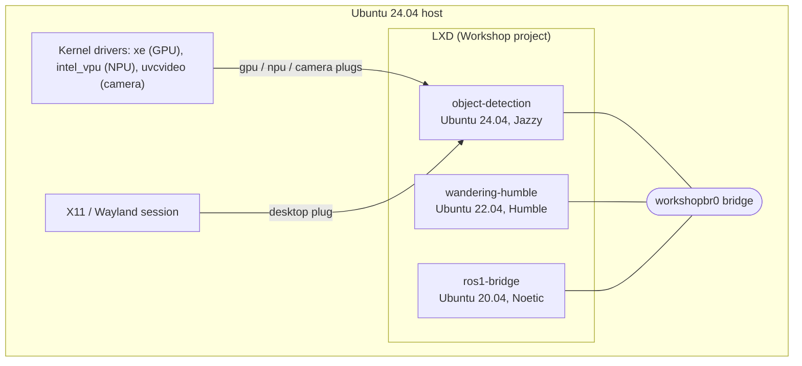

<!--
Copyright (C) 2026 Intel Corporation

SPDX-License-Identifier: Apache-2.0
-->

# Architecture

How the workshops in this repository are built, and how to add one. For Workshop itself, see the [Canonical Workshop documentation](https://ubuntu.com/workshop/docs/).

## Overview



Each workshop is an LXD system container managed by Workshop. Its user space follows the definition's `base` (Ubuntu release and ROS 2 distro), but it runs on the host's kernel and GPU/NPU drivers. Devices and the desktop reach the container through Workshop interfaces (plugs). All workshops and the host share the `workshopbr0` network bridge, so ROS 2 discovery works between them.

## Repository layout

```
src/workshops/
  sdks/                   In-project SDKs, shared by the workshops through symlinks
    proxy/                The host's proxy (hooks/proxy.env from scripts/configure-proxy.sh) for apt, curl, wget, cargo and dirmngr (listed first)
    intel-accel/          gpu + npu plugs, GPU and NPU user-space drivers, clinfo, vainfo, qmassa
    robotics-ai-suite/    gpu + npu + desktop plugs; runs the Robotics AI Suite installer, then apt-packages.txt
    ros2/                 gpu + npu + desktop plugs; ROS 2 Lyrical from packages.ros.org (Ubuntu 26.04 only)
    docker/               Docker and Compose inside the workshop, daemon behind the proxy
    camera/               camera plug only (/dev/video*, /dev/media*)
    ros1-bridge/          ROS 1 Noetic, ROS 2 Foxy and ros1_bridge (Ubuntu 20.04 only)
  accel-check/, realsense/, ros1-bridge/   Workshops with no component of their own
  scripts/                Host-side scripts that drive more than one workshop
  docs/                   This documentation
src/components/<component>/workshop/       The component's workshop (the Workshop "project")
  .workshop/
    <workshop>.yaml       Ubuntu 24.04, Jazzy
    <workshop>-humble.yaml  Ubuntu 22.04, Humble
    proxy -> ../../../../workshops/sdks/proxy, robotics-ai-suite -> ../../../../workshops/sdks/robotics-ai-suite, ...
  apt-packages.txt        The component's packages
  *_check.py, *.rviz, patches/   Helpers used by the actions (visible in the workshop as /project)
  README.md               The workshop's page
```

A project directory can hold several definitions if they all live in `.workshop/<name>.yaml` (no top-level `workshop.yaml`). The workshop directory is mounted read-write in the container at `/project`.

## SDKs

An SDK is a directory with `sdk.yaml` (name and plugs) and optional `hooks/`. The definitions list them as `project-<name>`, which Workshop resolves to `.workshop/<name>/`; here those are symlinks to `src/workshops/sdks/`, so every workshop shares one copy.

| SDK | Plugs | Hooks | Used by |
|---|---|---|---|
| `proxy` | - | `setup-base`: the proxy from `proxy.env` (written on the host by `scripts/configure-proxy.sh`) in `/etc/environment`, apt, curl, wget, cargo, dirmngr; nothing without the file | All (listed first) |
| `intel-accel` | `gpu`, `npu` | `setup-base`: GPU user-space drivers (kobuk-team PPA), NPU driver (AMR repo), tools | accel-check |
| `robotics-ai-suite` | `gpu`, `npu`, `desktop` | `setup-project`: Robotics AI Suite installer, then `apt-packages.txt` | All ROS 2 workshops |
| `docker` | - | `setup-base`: Docker and Compose, daemon behind the proxy; `setup-project`: adds the user to the `docker` group | benchmark-framework |
| `camera` | `camera` | - | realsense |
| `ros1-bridge` | - | `setup-project`: Noetic, Foxy, `ros1_bridge` from packages.ros.org | ros1-bridge |
| `ros2` | `gpu`, `npu`, `desktop` | `setup-project`: ROS 2 Lyrical (`ros-base`, `ros-dev-tools`) from packages.ros.org and the GPU compute runtime from the Ubuntu archive, then the available entries of `apt-packages.txt`; base `ubuntu@26.04` only | benchmark-framework-lyrical |

SDKs are installed in the order listed. `setup-base` hooks run as root; `setup-project` hooks run as the `workshop` user, after the plugs auto-connect. The suite installer runs in `setup-project` so that its preflight check sees the GPU.

### The robotics-ai-suite SDK

The hook picks the ROS 2 distro and installer profile from the base:

| `base` | ROS 2 | Installer profile |
|---|---|---|
| `ubuntu@24.04` | Jazzy | `complete` |
| `ubuntu@22.04` | Humble | `full` |

It downloads `robotics-installer`, checks its SHA-256, and runs it once (`--auto`, plus `--proxy` behind the proxy). Then it installs the workshop's `apt-packages.txt`: one package per line, `#` comments allowed, `${ROS_DISTRO}` expanded. The list is installed on every build, so adding a package and refreshing is enough.

Ubuntu 26.04 isn't supported by the installer yet, and Intel's AMR and OpenVINO apt repos have no 26.04 builds. Workshops on `ubuntu@26.04` use the `ros2` SDK instead. It installs Lyrical from packages.ros.org and skips, with a message, any `apt-packages.txt` entry that apt doesn't know yet (for example `ros-lyrical-benchmark-framework`).

## Plugs

| Plug | Interface | Gives the container | Connects |
|---|---|---|---|
| `gpu` | `gpu` | `/dev/dri/card*`, `/dev/dri/renderD*` | Automatically |
| `npu` | `custom-device` (subsystem `accel`) | `/dev/accel/accel*` | By hand: `workshop connect <w>/<sdk>:npu :custom-device` |
| `desktop` | `desktop` | The host's X/Wayland display, for RViz and Gazebo | By hand: `workshop connect <w>/robotics-ai-suite:desktop` |
| `camera` | `camera` | `/dev/video*`, `/dev/media*`, with hot-plug | By hand: `workshop connect <w>/camera:camera` |

Workshop resolves the GPU and the display when the plug is connected. If either changes on the host (a reboot that renumbers the GPU, or a new X display after logging in again), reconnect the plug; see [Troubleshooting](troubleshooting.md).

## Jazzy and Humble pairs

Every ROS 2 component workshop (all except accel-check and ros1-bridge) has two definitions that differ only in `name` and `base`. To keep them identical otherwise:

- Actions use `$ROS_DISTRO` or `/opt/ros/*/setup.bash`, never a distro name.
- `apt-packages.txt` uses `ros-${ROS_DISTRO}-...`.
- Both definitions share the project directory, so they share `/project` and its helper scripts.

Results and known issues for Humble are in [Humble and interoperability](humble-and-interop.md).

## Actions

Actions are shell snippets in the definition, run with `workshop run <name> <action> [args]` (arguments arrive as `$1`, `$2`, ...). They are read from the definition at run time, so editing an action needs no refresh. Conventions used here:

- Actions that open a window first check the X display and, if it can't be opened, print the commands to reconnect the desktop plug.
- Headless check actions return non-zero on failure, so they can be scripted; most also print PASS or FAIL.
- An explicit `exit` makes `workshop run` return 1, even `exit 0`. To return a status, end with a command such as `(exit $RC)`.
- Actions don't read `~/.bashrc`, so `ROS_DOMAIN_ID` is unset (domain 0) unless the action sets it.
- Processes started in the background inside an action stop when the action ends. To run two sides at once (as [ros1-bridge](../ros1-bridge/README.md) does), start two `workshop run` commands from the host.

## Networking

All workshops sit on the `workshopbr0` LXD bridge with the host. ROS 2 discovery (multicast) reaches across it, so workshops on the same `ROS_DOMAIN_ID` see each other's topics, and the host can join them. See [ROS 2 from the host](humble-and-interop.md#ros-2-from-the-host). The container's hostname is the workshop name.

## What a refresh keeps

`workshop refresh <name>` applies changes to the definition or SDKs:

- Changing only actions needs no refresh.
- Changing an SDK (its hook, plugs or `sdk.yaml`) rebuilds the container. For the suite that re-runs the full installer (10-12 minutes).
- A rebuild keeps manually connected plugs but discards anything built or configured inside the container, for example `~/ov_ws` from `build-npu-fix` or SSH pairing from `authorize-remote.sh`. Re-run those steps.
- `workshop restore` resets the container to its last launch or refresh and also resets interface connections; reconnect the NPU and desktop afterwards.

## Adding a workshop

1. Create the workshop directory next to the component's source and link the SDKs:

   ```bash
   mkdir -p src/components/my-component/workshop/.workshop && cd src/components/my-component/workshop/.workshop
   ln -s ../../../../workshops/sdks/proxy proxy
   ln -s ../../../../workshops/sdks/robotics-ai-suite robotics-ai-suite
   ```

2. List the component's packages in `src/components/my-component/workshop/apt-packages.txt`, for example `ros-${ROS_DISTRO}-my-component`.
3. Write `.workshop/my-component.yaml`:

   ```yaml
   # Copyright (C) 2026 Intel Corporation
   #
   # SPDX-License-Identifier: Apache-2.0

   name: my-component
   base: ubuntu@24.04
   sdks:
     - name: project-proxy
     - name: project-robotics-ai-suite
   actions:
     demo: |
       source /opt/ros/*/setup.bash
       ros2 launch my_component demo.launch.py
   ```

4. Copy it to `.workshop/my-component-humble.yaml` and change `name` to `my-component-humble` and `base` to `ubuntu@22.04`.
5. Launch both, add a headless `*-check` action that prints PASS or FAIL, and add `src/components/my-component/workshop/README.md` with a "Get started with Workshop" section. Link it from the [workshop index](../README.md#workshops) and from the component's README.
6. Give every new file a REUSE license header (or cover it in the component's `REUSE.toml`), because component CI runs `make license-check`.
