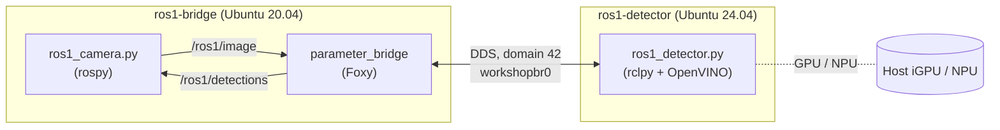

<!--
Copyright (C) 2026 Intel Corporation

SPDX-License-Identifier: Apache-2.0
-->

# ros1-bridge

A ROS 1 Noetic application talking to Robotics AI Suite inference on ROS 2 Jazzy, through `ros1_bridge`. The suite supports only ROS 2, and Noetic and `ros1_bridge` exist only for Ubuntu 20.04, so this uses two workshops (#455):

| Workshop | Base | Runs |
|---|---|---|
| `ros1-bridge` | Ubuntu 20.04 | ROS 1 Noetic (`roscore`, a camera node) and ROS 2 Foxy `ros1_bridge`, from packages.ros.org |
| `ros1-detector` | Ubuntu 24.04 | The Robotics AI Suite (Jazzy) and the object detection tutorial's SSD model with OpenVINO on CPU, GPU or NPU |



The ROS 1 camera publishes a raw RGB frame (`sensor_msgs/Image`) at a fixed rate. The bridge carries it to ROS 2, where the detector runs SSD MobileNet v2 and publishes the detections as JSON (`std_msgs/String`). The bridge carries them back, and the camera measures the round trip per frame.

- Definitions: [ros1-bridge.yaml](.workshop/ros1-bridge.yaml), [ros1-detector.yaml](.workshop/ros1-detector.yaml)
- SDKs: `proxy` and `ros1-bridge` ([setup-project](../sdks/ros1-bridge/hooks/setup-project): Noetic, Foxy, `ros1_bridge`, Cyclone DDS) for `ros1-bridge`; `proxy` and `robotics-ai-suite` for `ros1-detector`
- Packages: [apt-packages.txt](apt-packages.txt) (used by `ros1-detector` only)
- Nodes: [ros1_camera.py](ros1_camera.py), [ros1_detector.py](ros1_detector.py)
- Check: [scripts/ros1-bridge-check.sh](../scripts/ros1-bridge-check.sh)

## Get started with Workshop

Requires the [prerequisites](../docs/getting-started.md#prerequisites).

```bash
cd src/workshops/ros1-bridge
workshop launch ros1-bridge                 # about 2 min
workshop launch ros1-detector               # full suite install, about 11 min
workshop connect ros1-detector/robotics-ai-suite:npu :custom-device   # only for NPU
cd ..
./scripts/ros1-bridge-check.sh              # GPU, 640x480 @ 10 Hz, 30 s
./scripts/ros1-bridge-check.sh NPU 1280 720 30 30
```

The script runs both sides from the host and prints PASS if at least 95% of frames get their detections back:

```
scripts/ros1-bridge-check.sh [device] [width] [height] [hz] [seconds] [rmw]
```

| Argument | Default | |
|---|---|---|
| `device` | `GPU` | `CPU`, `GPU` or `NPU` |
| `width` `height` | `640` `480` | Frame size; the frame is generated on first use |
| `hz` | `10` | Publish rate |
| `seconds` | `30` | Measured time, after an 8 s warm-up |
| `rmw` | `rmw_cyclonedds_cpp` | ROS 2 middleware on both sides; `rmw_fastrtps_cpp` also works |

## Actions

The check script uses these; you can also run them by hand in two terminals (start the detector first).

| Workshop | Action | Description |
|---|---|---|
| `ros1-detector` | `frames [width] [height]` | Writes the tutorial's `coco_bike.jpg` as a raw RGB frame to `ros1-bridge/frames/` |
| `ros1-detector` | `detect [device] [max_seconds] [rmw]` | Detector on ROS 2 domain 42. Prints `ready` once the model is compiled; exits 5 s after the last frame |
| `ros1-bridge` | `bridge-detect [width] [height] [hz] [seconds] [rmw]` | `roscore`, `parameter_bridge` for `/ros1/image` and `/ros1/detections`, then the ROS 1 camera. Returns 1 if fewer than 95% of frames are answered |

## Results

Panther Lake (Core Ultra X7 358H), Cyclone DDS unless noted, 2026-10-08. All runs answered 100% of frames with the same labels (bicycle, car).

| Input | Device | Round trip p50 | p90 | Resize + inference p50 |
|---|---|---|---|---|
| 640x480 @ 10 Hz | GPU | 4.7 ms | 5.3 ms | 1.68 ms |
| 1280x720 @ 30 Hz | NPU | 10.8 ms | 12.2 ms | 3.83 ms |
| 1280x720 @ 30 Hz | GPU, Fast DDS | 11.5 ms | 15.7 ms | 1.77 ms |

Latencies vary between runs: repeated GPU runs at 640x480 @ 10 Hz gave a round-trip p50 of 4.7-8.4 ms (6.0 ms in the feasibility run). Compare devices from runs made back to back.

The feasibility runs on 2026-10-06 also covered CPU (640x480 @ 10 Hz: 9.1 ms) and a baseline without the bridge, with the camera on ROS 2 in the same workshop as the detector. The bridge added about 2-4 ms per round trip.

## Design notes

- **`parameter_bridge`, not `dynamic_bridge`.** `dynamic_bridge` crashes when it reads the graph information of Jazzy nodes. `parameter_bridge` bridges a fixed list of topics (set with `rosparam set /topics`) and works.
- **Why Foxy.** Foxy's `ros-foxy-ros1-bridge` is the only packaged `ros1_bridge`. No package exists for Humble or Jazzy (checked packages.ros.org, the ROS-O repository and the Ubuntu archive in October 2026), so any other ROS 2 distro means building the bridge from source. `zenoh-bridge-ros1` only bridges ROS 1 to Zenoh, not to ROS 2. If Workshop drops Ubuntu 20.04 bases, the fallback is [ROS-O](https://ros.packages.techfak.net/) (Noetic-based ROS 1 packages for Ubuntu 22.04 and 24.04) with a bridge built from source.
- **Foxy talks to Jazzy.** The bridge is a Foxy node, and both Cyclone DDS and Fast DDS carried `sensor_msgs/Image` and `std_msgs/String` between Foxy and Jazzy. Mixing distros is not officially supported; types whose definitions differ between Foxy and Jazzy may not work (see [Humble and Jazzy on the same domain](../docs/humble-and-interop.md#humble-and-jazzy-on-the-same-domain) for the same effect between Humble and Jazzy).
- **Domain 42.** Both sides use `ROS_DOMAIN_ID=42`, so the loop doesn't mix with other workshops on the default domain 0.
- **`CYCLONEDDS_URI` is unset** on the Jazzy side, because the suite sets it to a file that doesn't exist. See [Troubleshooting](../docs/troubleshooting.md#cyclone-dds-fails-to-start-in-a-jazzy-workshop).
- **Resize on the CPU.** The detector resizes with OpenCV. With OpenVINO's embedded resize (PrePostProcessor), the NPU returns no detections. This is the same problem as the [object-detection NPU issue](../../components/object-detection/workshop/README.md#known-issues), whose upstream fix also removes the embedded resize.
- **Ubuntu 20.04 base.** Workshop launches it but warns that 20.04 bases are no longer supported and will need 22.04 or later before the next Workshop release. Noetic and `ros1_bridge` packages exist only for 20.04, so this approach depends on that support. Noetic and Foxy are both end of life.
- **Consumers on the host.** A host-side ROS 2 node with Cyclone DDS needs the `ros1-bridge` workshop's IP as a unicast peer to see the bridged topics.
